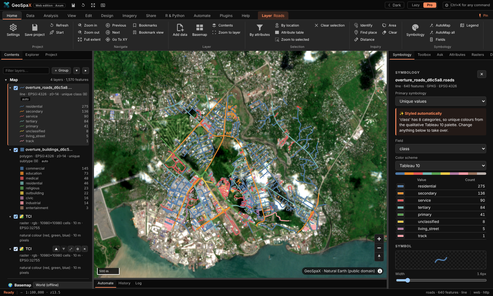

<p align="center"></p>

<h1 align="center">GeoSpaX</h1>

<p align="center"><b>The open-source GIS where maps make themselves.</b><br>
Desktop, web and phone · one Rust engine · MIT licence</p>

<p align="center">
  <a href="https://github.com/jmozez/geospax/releases/latest"></a>
  <a href="https://github.com/jmozez/geospax/actions/workflows/ci.yml"></a>
  <a href="LICENSE"></a>
</p>

<p align="center"></p>

GeoSpaX is for people who want a finished map without spending hours on it. Drop in data, or plug in a
phone, GPS, drone card, camera or sensor logger, and GeoSpaX styles it, lays out the map, writes the
report and exports PNG, PDF and SVG. When you want control, a full ArcGIS Pro-style workbench is one click
away.

## Features

- **Two modes, one engine.** *Lazy*: layer cards, a task bar and plain-language next steps. *Pro*: an ArcGIS
  Pro-style ribbon, layer tree, attribute table, editing and every pane.
- **Maps that style themselves.** AutoMap picks the field, classes and colours and says why; full
  symbology for points, lines, polygons, labels and rasters when you want your own.
- **Finished maps and reports.** Layout with legend, scale bar, north arrow and inset; Equal Earth for world
  maps; 150–1200 dpi PNG, vector PDF and SVG; map series and multi-panel pages.
- **Analysis.** About 1,130 tools in one Toolbox (vector, raster, terrain, hydrology, imagery, LiDAR),
  hot spots and kriging, and domain plugins for agriculture, biodiversity, climate, conservation,
  forestry, hydrology, marine, soil and more.
- **Data from anywhere.** Files, devices and phones, plus online data cut to your area with citations:
  WorldClim, CHELSA, CMIP6, SoilGrids, GBIF, OBIS, iNaturalist, GADM, Copernicus DEM, GEBCO, Hansen forest
  change, ecoregions.
- **Automation.** Every result is a re-runnable recipe; triggers run them when a device is plugged in, a
  folder changes, a schedule fires or a live sensor crosses a threshold.
- **R, Python and AI.** R and Python as recipe steps with an R console and templates; an assistant (Ollama,
  OpenAI-compatible or Claude) and an MCP server.
- **Private by default.** Everything runs on your computer and works offline.

## Download

| System | Installer |
|---|---|
| Windows 10 / 11 | [`GeoSpaX_<version>_x64-setup.exe`](https://github.com/jmozez/geospax/releases/latest) (no administrator rights needed) or the portable ZIP |
| Debian 13 / Ubuntu | [`geospax_<version>_amd64.deb`](https://github.com/jmozez/geospax/releases/latest), then `sudo apt install ./geospax_<version>_amd64.deb` |
| Any system (web edition) | `docker compose up -d`, then open the link printed by `docker compose logs geospax` |

macOS is not packaged yet; use the web edition or [build from source](docs/DEVELOPMENT.md).

## Quick start

1. Start **GeoSpaX**. It opens on a clean map with the globe.
2. Drop a file on the window (GeoJSON, GeoPackage, Shapefile, KML, GPX, CSV, GeoTIFF, LAS/LAZ), or choose
   **Data › Sample data**.
3. Press **Finish my map**: a laid-out map and a one-page report, ready to print or share.

The web edition (`geospax-server`) answers at <http://localhost:8080> on this computer only; see
[Security](SECURITY.md) to open it to other devices.

## Documentation

| Guide | |
|---|---|
| [User guide](docs/USER_GUIDE.md) | Install, your first map, the workbench, recipes, troubleshooting |
| [FAQ](docs/FAQ.md) | Answers to the common questions |
| [Automation](docs/AUTOMATION.md) | Recipes, triggers, autopilot, R and Python steps |
| [Plugins](docs/PLUGINS.md) · [GSX tools](docs/GSX.md) · [R](docs/R.md) · [AI](docs/AI.md) · [Devices](docs/DEVICES.md) | The rest of the program in depth |
| [What's new](CHANGELOG.md) | Every release |
| [Development](docs/DEVELOPMENT.md) | Build from source, tests, benchmarks, the engine API |

In the app, **Help** opens the same guides as a searchable web page.

## Build from source

```bash
scripts/setup-linux.sh            # GDAL, Rust, Node.js (Debian/Ubuntu)
. /opt/rust-env.sh
(cd web && npm ci && npx vite build)
cargo build --release -p geospax-server
./target/release/geospax-server --data ~/GeoSpaX/Data --web web/dist   # http://localhost:8080
```

Packaging, the test suite and benchmarks are described in [Development](docs/DEVELOPMENT.md).

## Contributing

Bug reports and ideas are welcome in [issues](https://github.com/jmozez/geospax/issues). Please include what
you did, what you expected and what happened; **Help › Engine diagnostics** shows details worth adding.
Security problems: see [SECURITY.md](SECURITY.md).

## Licence and credits

GeoSpaX is released under the [MIT licence](LICENSE). It brings together GeoSpaX 1.4.2
([map-kit](https://github.com/jm0535/map-kit)) and 2.0 ([GeoSpaX](https://github.com/jm0535/GeoSpaX)), and
learns from ArcGIS Pro, QGIS, [GeoLibre](https://github.com/opengeos/geolibre) and
[RustGIS](https://github.com/opengeos/RustGIS). Third-party components and data are credited in
[THIRD_PARTY_NOTICES.md](THIRD_PARTY_NOTICES.md).
