<p align="center"></p>

<h1 align="center">GeoSpaX</h1>

<p align="center"><b>The open-source GIS where maps make themselves.</b><br>
Desktop, web and phone · one Rust engine · MIT licence</p>

<p align="center">
  <a href="https://github.com/jmozez/geospax/releases/latest"></a>
  <a href="https://github.com/jmozez/geospax/actions/workflows/ci.yml"></a>
  <a href="LICENSE"></a>
</p>

<p align="center"></p>

<table><tr>
<td width="50%"><br /><b>Lazy mode</b>: layer cards that explain each layer, a task bar, one-click next steps and the layer's story in the Layer tab.</td>
<td width="50%"><br /><b>It starts on the globe</b>: a clean slate over world imagery, with the map's basemap, projection and next steps in the Layer tab.</td>
</tr></table>

GeoSpaX is for people who want a finished map without spending hours on it. Drop in data, or plug in a
phone, GPS, drone card, camera or sensor logger, and GeoSpaX styles it, lays out the map, writes the
report and exports PNG, PDF and SVG. When you want control, a full ArcGIS Pro-style workbench is one click
away.

## Features

- **Two modes, one engine.** *Lazy*: layer cards, a task bar and plain-language next steps. *Pro*: an ArcGIS
  Pro-style ribbon, layer tree, attribute table, editing and every pane.
- **A workbench laid out like the work.** The ribbon runs Home, View, Edit, Design, Imagery, Analysis,
  Share; on the left **Project · Explorer · Contents** (files, online data, recipes, R & Python, plugins
  and devices live in the Explorer); on the right **Layer · Tools · Ask** (the selected layer's style,
  labels, fields and source; the Toolbox; the assistant); under the map the attribute table and the runs.
- **Every ribbon tab does real work.** Swipe and Spyglass to compare a layer with the map under it, a time
  slider for any date or year field, a map grid, split, merge, cut and reshape, attribute rules and topology
  checks, zonal statistics with exact cell coverage, network routes and service areas, and a web map in a
  single HTML file. The [user guide](docs/USER_GUIDE.md#the-ribbon-tools-tab-by-tab) goes through them tab
  by tab.
- **Maps that style themselves.** AutoMap picks the field, classes and colours and says why; full
  symbology for points, lines, polygons, labels and rasters when you want your own.
- **Finished maps and reports.** Layout with legend, scale bar, north arrow and inset; Equal Earth for world
  maps; 150–1200 dpi PNG, vector PDF and SVG; map series and multi-panel pages.
- **Analysis.** About 1,130 tools in one Toolbox (vector, raster, terrain, hydrology, imagery, LiDAR),
  hot spots and kriging, and domain plugins for agriculture, biodiversity, climate, conservation,
  forestry, hydrology, marine, soil and more.
- **Data from anywhere.** Files, devices and phones, plus online data cut to your area with citations:
  WorldClim, CHELSA, CMIP6, SoilGrids, GBIF, OBIS, iNaturalist, GADM, Copernicus DEM, GEBCO, Hansen forest
  change, ecoregions.
- **Design and CAD.** Lines, polygons, arcs (3 points), ellipses, roads from a centreline, offsets of lines and shapes (by distance or through a point), a Layer Properties manager (colour, linetype, lineweight, on/off, lock), locked layers, dimensions (linear and angular), leaders, a traverse (COGO)
  with its misclosure; Move, Copy, Rotate, Scale, Mirror, Align, Stretch, Array, Polar array (previewed as you type),
  Union, Subtract, Intersect, Trim, Extend, Fillet, Chamfer, Join, Break, Lengthen, Explode, List and Erase on any feature; Divide and Measure;
  Blocks and Insert; Undo and Redo; hatch patterns (exported to DXF as hatch lines); snap, ortho and polar,
  typed input such as `25<90` and `@10,5`, and DXF to and from AutoCAD.
- **Automation.** Every result is a re-runnable recipe; triggers run them when a device is plugged in, a
  folder changes, a schedule fires or a live sensor crosses a threshold.
- **R, Python and AI.** R and Python as recipe steps with an R console and templates; an assistant (Ollama,
  OpenAI-compatible or Claude) and an MCP server.
- **Private by default.** Everything runs on your computer and works offline.

## Tours

**Compare and play through time.** *Swipe* (View tab) shows the selected layer on one side of a divider and
the map without it on the other; *Time slider* plays a layer through its dates, and tools and exports see
the same features as the map.

<table>
<tr>
<td width="50%"></td>
<td width="50%"></td>
</tr>
</table>

**Design a subdivision.** A 76-lot estate east of Lae, Papua New Guinea, drawn with the Design tab over
Esri World Imagery: two 12 m access roads and a 15 m collector, 20 × 30 m lots, a public reserve, a water
tank and dimensions, all typed into the command line. *Export DXF* hands it to AutoCAD in UTM metres.

<p align="center"></p>

**Rivers and catchments.** The Markham valley from the Copernicus 30 m DEM: GeoSpaX's `hydro.network` fills depressions, routes flow (D8) and extracts 1,674 stream links coloured by Strahler order (1 to 5), with the 7 drainage basins that lie wholly inside the DEM outlined in yellow, over a soft hillshade and Esri World Imagery.

<p align="center"></p>

**Land cover.** ESA WorldCover 10 m (2021) for Lae and the Markham delta, downloaded for the area with *Explorer › Online data* and drawn in ESA's class colours; the legend gives each class's share of the area, so you see at a glance how much is tree cover, built-up land or water.

<p align="center"></p>

**Supervised classification.** Nine land-cover classes from Google DeepMind's AlphaEarth satellite embeddings (64 values per pixel, 1.1 million pixels at 20 m), k-nearest neighbours trained on 360 points labelled from WorldCover (white dots); leave-one-out accuracy 80.3 %.

<p align="center"></p>

**Unsupervised classification.** The same embeddings grouped into eight kinds of landscape by k-means with no training samples at all: rivers, mangroves, town and forest separate on their own.

<p align="center"></p>

**LiDAR in 3D.** 23 million USGS 3DEP points of downtown San Francisco (615 Entwine tiles) gridded in
12 seconds into terrain, surface and canopy models; the 184 buildings found are raised to their measured
roof heights with *Extrude in 3D* over Esri World Imagery.

<p align="center"></p>

**Network analysis.** Which streets in Lae are within 500 m, 1 km and 2 km by road of the nearest of 16 hospitals and clinics (red crosses), measured along 2,456 Overture roads with the network service-area tool of the Toolbox; grey streets are further than 2 km.

<p align="center"></p>

**Mount Wilhelm in 30 m.** The Copernicus GLO-30 DEM for the area around Papua New Guinea's highest peak (338 to 4,473 m), fetched with *Online data › Elevation* in seconds and tinted green to white, with its histogram and band statistics.

<p align="center"></p>

The same DEM in 3D: *View › 3D terrain* raises it as live terrain you can tilt and turn. For a print-quality 3D relief, the **3D relief with rayshader** analysis (R) renders it with ray-traced shadows and ambient occlusion.

<p align="center"></p>

## Plugin showcases

Each domain plugin run in GeoSpaX on open data around Lae and the Huon Gulf, Papua New Guinea, over Esri
World Imagery. The plugins share one tested toolkit (GSX), so a tool behaves the same in every domain.

**Agriculture · weighted suitability.** Where new gardens could go: 2,529 land cells of 1 km along the Markham valley scored by gentle slope (weight 3), open land (2) and low ground (1) from the Copernicus 30 m DEM and Hansen tree cover, in five quantile classes from least to most suitable.

<p align="center"></p>

**Biodiversity · richness and diversity.** 1,904 GBIF bird records around Lae summarised on 5 km hexagons: 244 species in all, up to 94 in one hexagon, and a Shannon diversity of 4.68 for the area, with Simpson and evenness per hexagon in the attribute table.

<p align="center"></p>

**Climate · flood exposure.** The same 2,529 land cells scored by low ground (weight 2) and low average elevation (1): exposure is highest on the Markham floodplain and the coast at Lae.

<p align="center">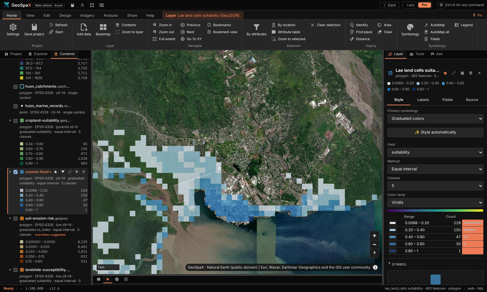</p>

**Conservation · weighted hotspot grid.** 1,197 OBIS fish records counted on an 8 km grid over GEBCO bathymetry: 68 of 740 cells hold records, and the hottest sit off Lae and along the Huon Peninsula coast.

<p align="center">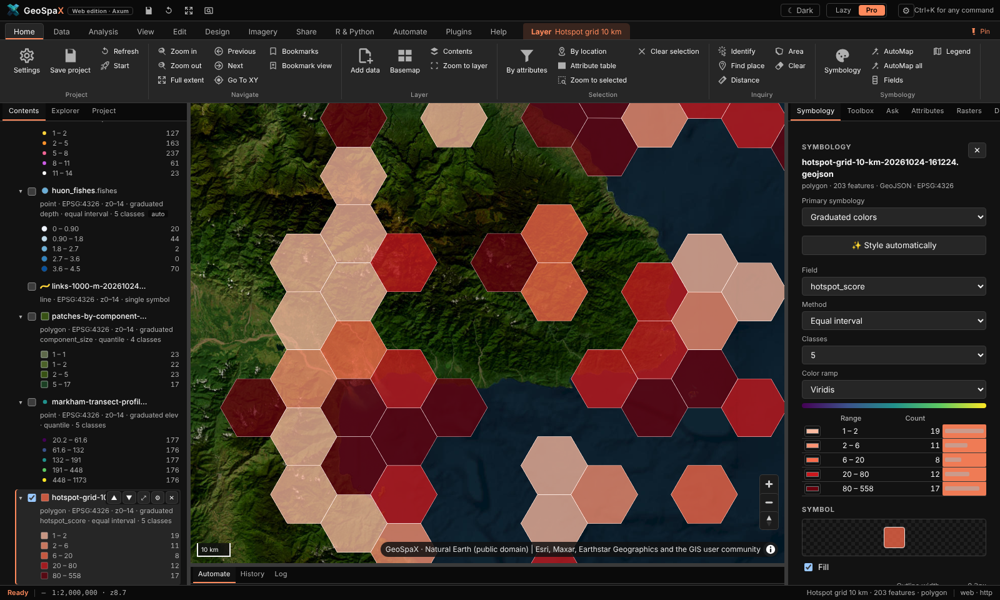</p>

**Disaster · landslide susceptibility.** Slope (weight 3), local relief (2) and little tree cover (1) combined into a 0 to 1 score on the same land cells: the steep, cleared ranges above the valley score highest.

<p align="center">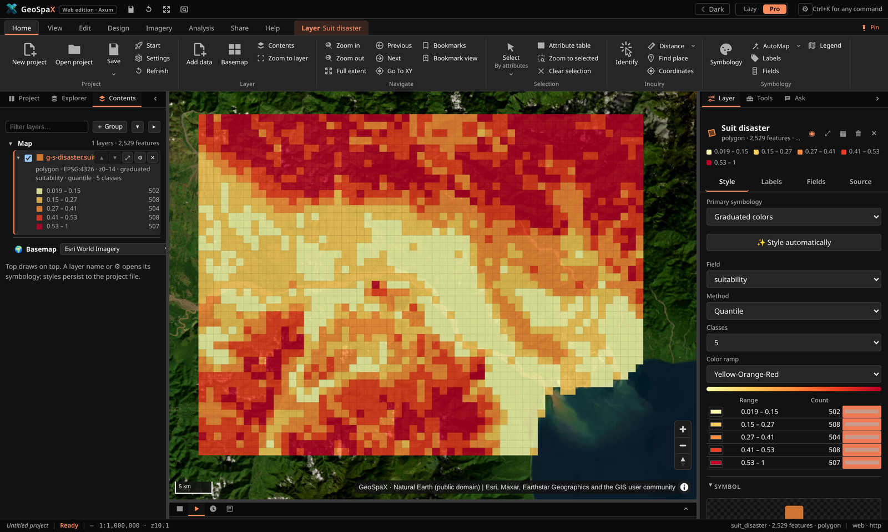</p>

**Environment · elevation profile.** A 39.1 km transect from the Saruwaged foothills to the Huon Gulf sampled on the Copernicus 30 m DEM at 634 points, coloured by height: from sea level to 1,730 m, with 3,102 m of climb along the way.

<p align="center">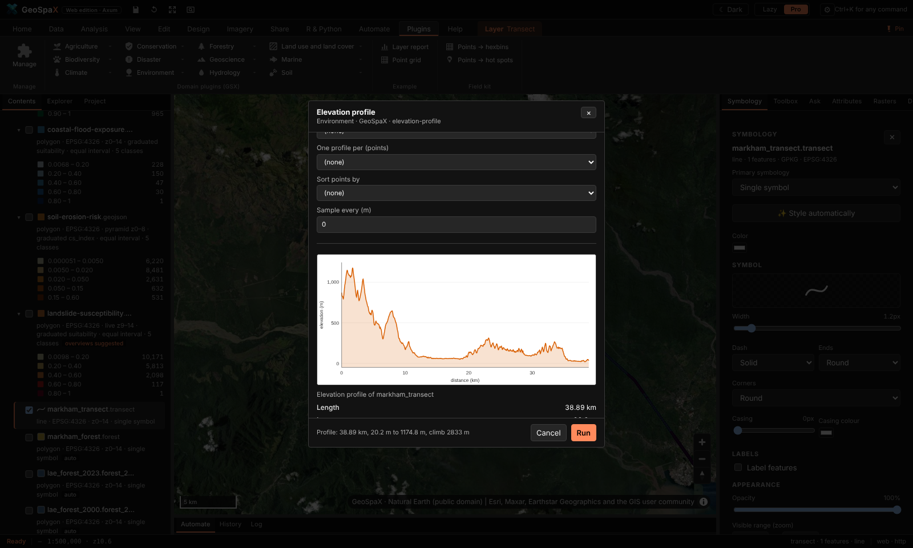</p>

**Forestry · fragmentation and core forest.** 69 forest patches of 20 ha or more from Hansen tree cover (canopy 60 % or more, no loss since 2000), outlined in orange, with the core forest more than 300 m from any edge in green: 83.7 % of the forest is core.

<p align="center"></p>

**Geoscience · slope zones.** Horn slope from the Copernicus 30 m DEM in three zones across the Markham valley: 41 % under 8° (green), 23 % from 8° to 20° (amber) and 36 % at 20° and over (red).

<p align="center">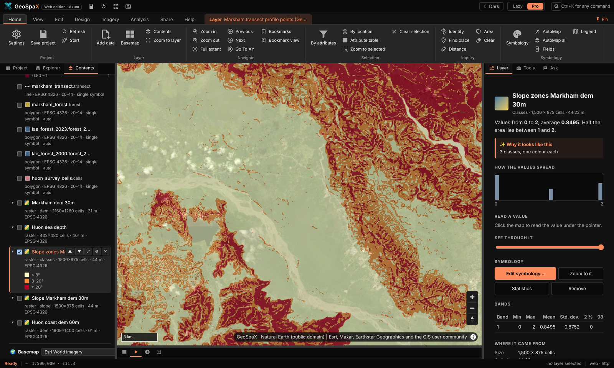</p>

**Hydrology · wet ground.** The land cells scored by low ground (weight 2), gentle slope (1) and little tree cover (1) to show where water gathers and lingers on the Markham floodplain (see the Rivers and catchments tour above for the stream network).

**Land use and land cover · forest loss by year.** Hansen Global Forest Change along the Markham valley: 18,021 ha of tree cover lost from 2001 to 2025, coloured by the year it went, with the worst year 2022 (2,745 ha).

<p align="center">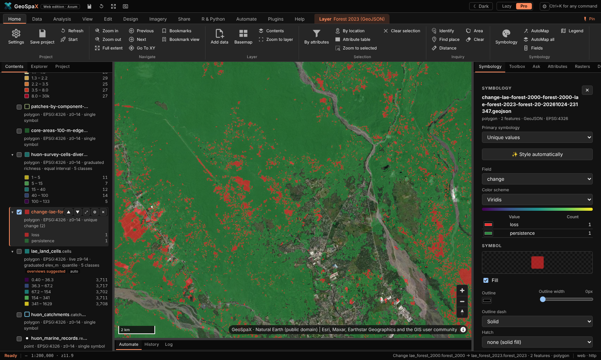</p>

**Marine · clean records, then clusters.** The new on-land check flagged 242 of 1,197 OBIS fish records that sit on land (mostly old museum specimens pinned to a town or a 0.1° grid point), dropped them, and DBSCAN grouped the 955 marine records into 20 clusters (47 left as noise, in grey) over GEBCO 2026 bathymetry of the Huon Gulf.

<p align="center"></p>

**Soil · erosion potential.** Steep slope (weight 3) and bare or open ground (2) scored on the same land cells, ranking where soil is most likely to wash off in heavy rain.

<p align="center">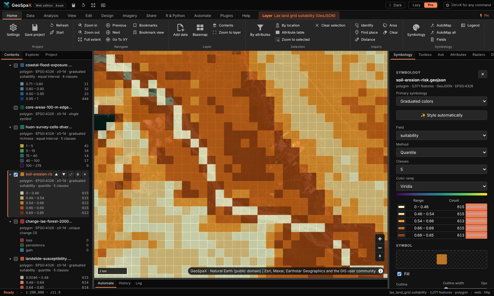</p>

## Industry maps

Twelve finished maps, one per industry kit, made in GeoSpaX (Pro mode, dark theme) on real basemaps and real Papua New Guinea locations. Each has a title, legend, scale bar, north arrow, grid, credits and a CRS note. Illustrative or simulated data is marked on each map.

### Surveying: Plan a lot in minutes, not days.

Bearings and distances from the real OpenStreetMap lot outline in Lae, a Bowditch-adjusted traverse and a PNG94 / UTM 55S grid, ready to print at 1:2,500.

<p align="center">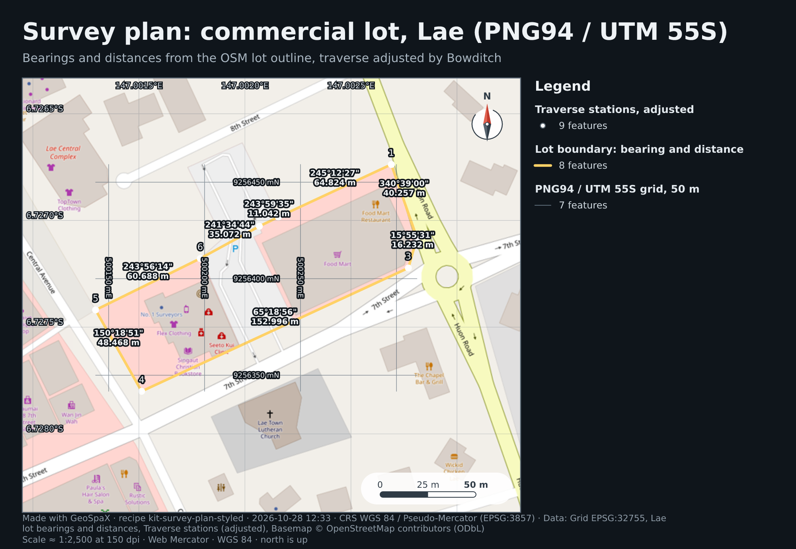</p>

### Power lines: See every easement at a glance.

The real OpenStreetMap transmission line near Lae on Esri imagery, with 20 m easement, 50 m clearance and 100 m consultation zones. Tower types and span checks are illustrative.

<p align="center">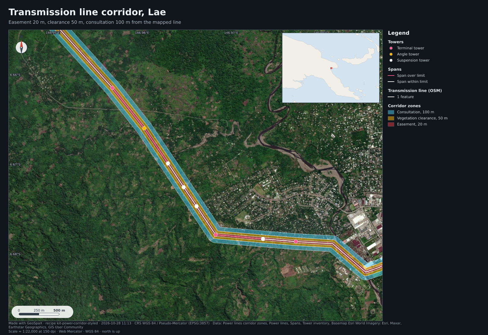</p>

### Petroleum and gas: Spot tenure clashes before they cost you.

Illustrative licence blocks at Hides, Hela Province, over real OpenStreetMap villages, with overlaps flagged and a least-cost pipeline route on the real terrain.

<p align="center">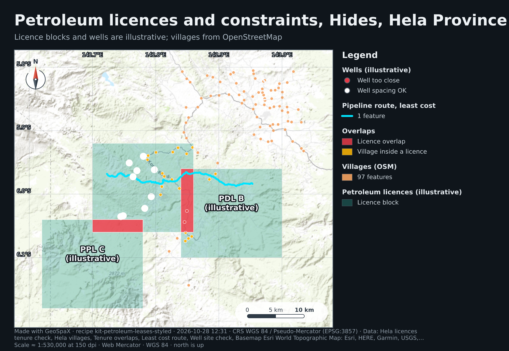</p>

### Mining: Measure cut and fill from free elevation data.

Surface change at Ok Tedi from SRTM (2000) to the Copernicus DEM, in metres, with an illustrative lease outline.

<p align="center">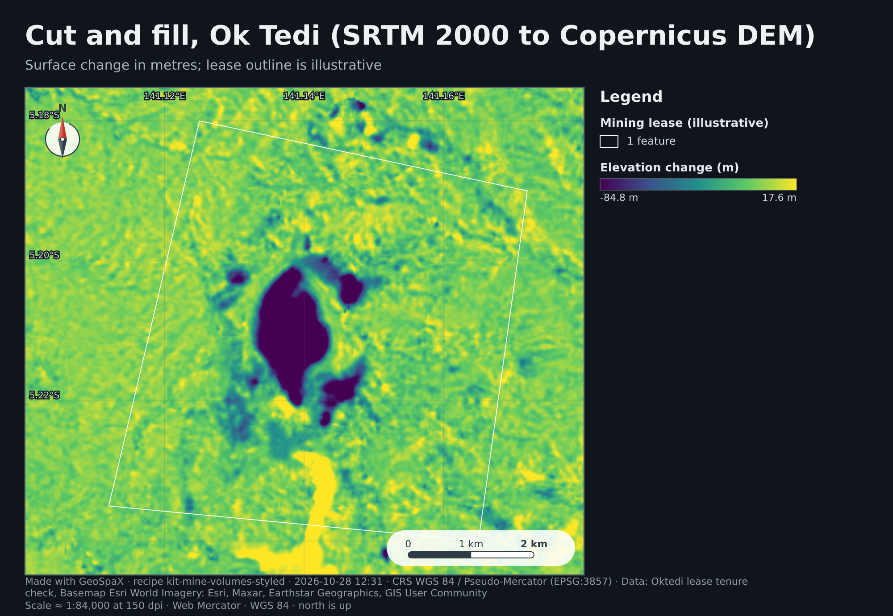</p>

### Logging: Know your net harvest area before the first tree falls.

Illustrative coupes at Bulolo, Morobe Province, net of slopes over 30° and real OpenStreetMap stream buffers, with a least-cost haul road.

<p align="center">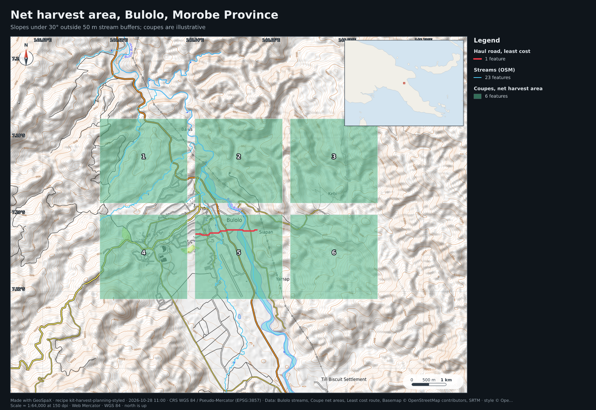</p>

### Maritime: Turn AIS reports into patrol targets.

AIS density, vessel tracks and loitering events in the Huon Gulf off the Port of Lae. The AIS tracks are simulated.

<p align="center">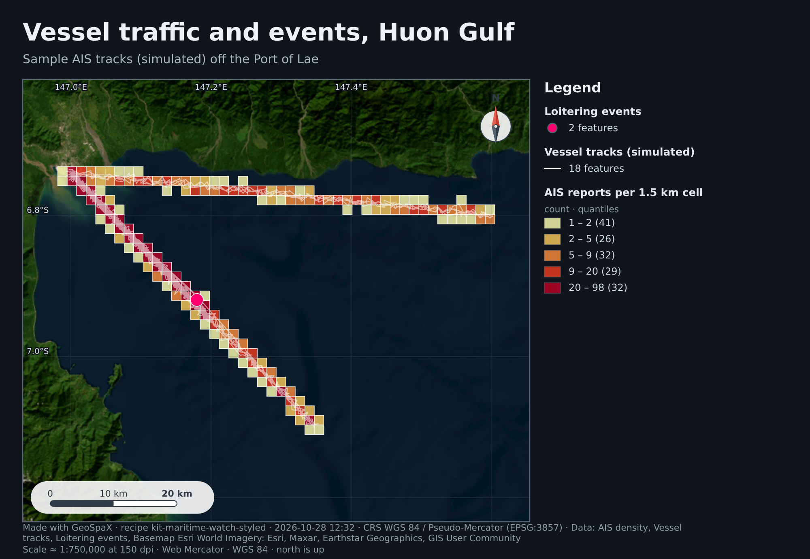</p>

### Aerodromes: Protect your airspace, obstacle by obstacle.

ICAO Annex 14 obstacle limitation surfaces for the real Nadzab (AYNZ) runway, with OpenStreetMap buildings checked against them. Obstacle heights are assumed.

<p align="center">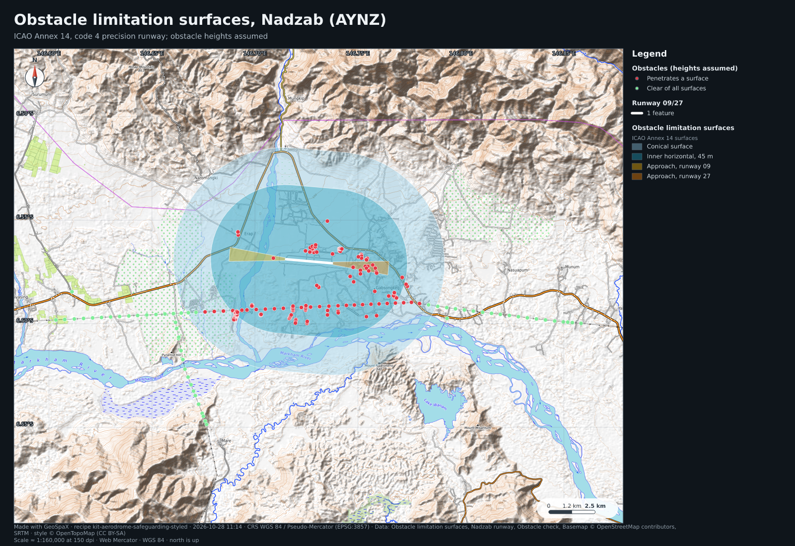</p>

### Logistics: Cut kilometres off every delivery run.

Drive-time bands from the Lae port depot on real OpenStreetMap roads, and the optimised order to visit each stop.

<p align="center">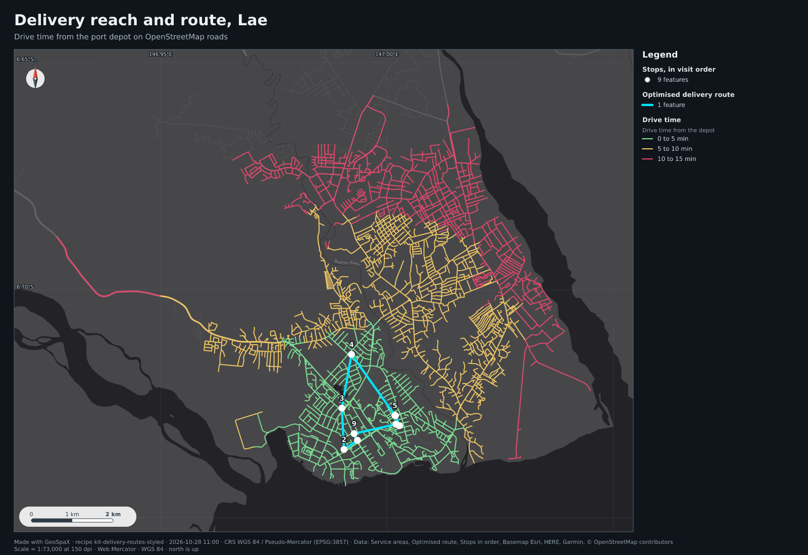</p>

### Urban planning: Show who is within walking distance of a park.

Real OpenStreetMap land use and buildings in Lae, with every home checked against a 400 m walk to green space.

<p align="center">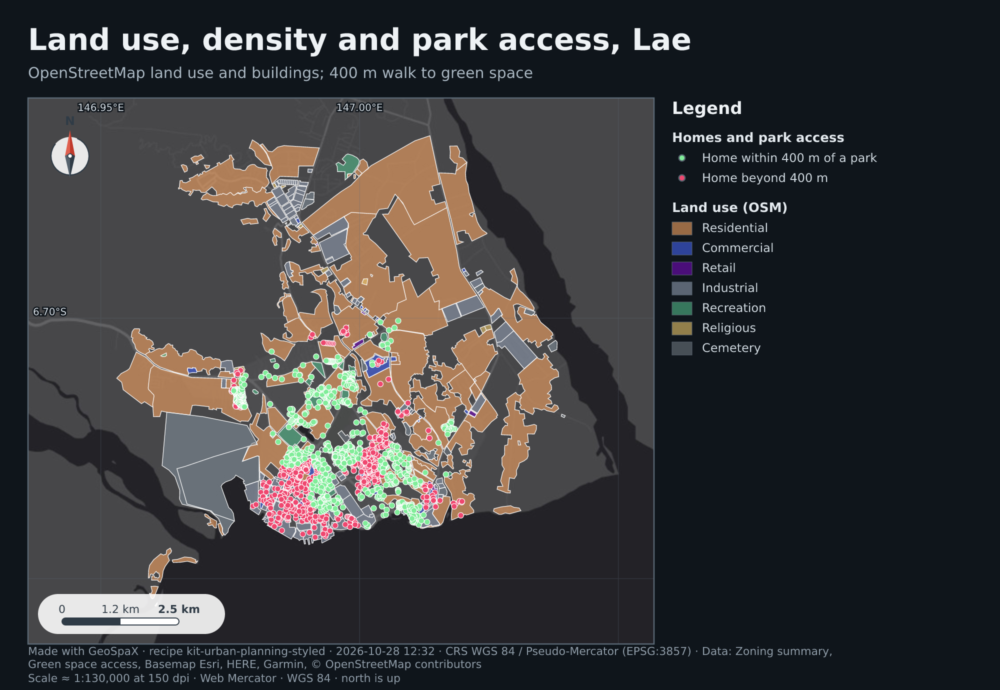</p>

### Rural development: Find the villages furthest from clinics and schools.

Real OpenStreetMap villages, clinics and schools in the Morobe highlands, graded by straight-line distance in km.

<p align="center">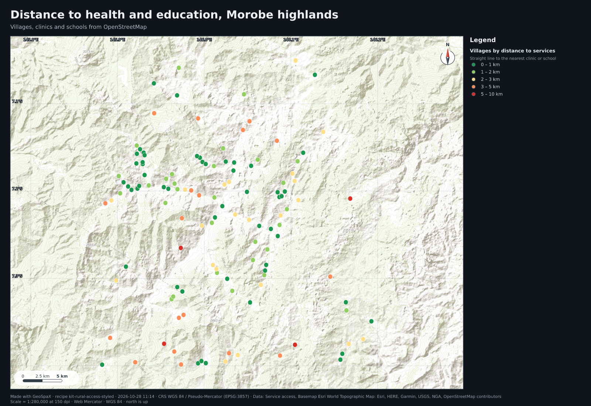</p>

### Asset management: Put your highest-risk assets on the map first.

Real OpenStreetMap asset locations in Lae, ranked by condition and criticality, with changes since 2025. Register attributes are illustrative.

<p align="center">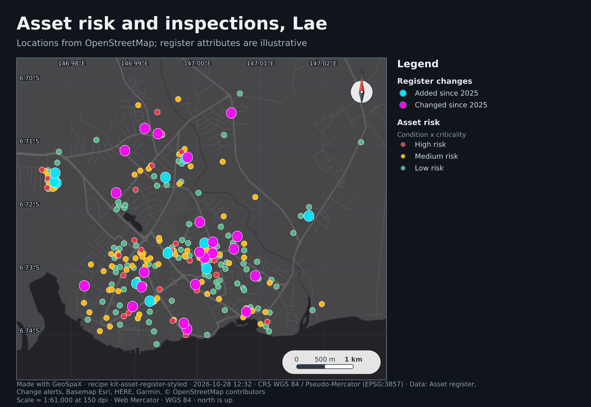</p>

### Climate and El Niño: See drought coming, province by province.

CHIRPS v3 rainfall for October to December 2015 as a percentage of the 1991 to 2020 normal across Papua New Guinea, with the NOAA Oceanic Niño Index.

<p align="center">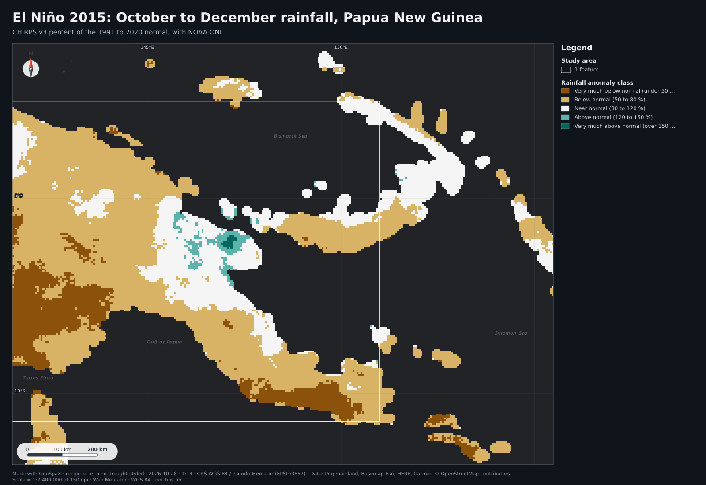</p>


## Download

| System | Installer |
|---|---|
| Windows 10 / 11 | [`GeoSpaX_<version>_x64-setup.exe`](https://github.com/jmozez/geospax/releases/latest) (no administrator rights needed) or the portable ZIP |
| Any Linux | [`GeoSpaX-<version>-x86_64.AppImage`](https://github.com/jmozez/geospax/releases/latest): one file, no installing; `chmod +x GeoSpaX-*.AppImage`, then run it. Needs a 2024-or-newer distribution (glibc 2.39). |
| Any system (web edition) | `docker compose up -d`, then open the link printed by `docker compose logs geospax` |

macOS is not packaged yet; use the web edition or [build from source](docs/DEVELOPMENT.md).

## Quick start

1. Start **GeoSpaX**. It opens on a clean map with the globe.
2. Drop a file on the window (GeoJSON, GeoPackage, Shapefile, KML, GPX, CSV, GeoTIFF, LAS/LAZ), or choose
   **Explorer › Sample data**.
3. Press **Finish my map**: a laid-out map and a one-page report, ready to print or share.

The web edition (`geospax-server`) answers at <http://localhost:8080> on this computer only; see
[Security](SECURITY.md) to open it to other devices.

## Documentation

| Guide | |
|---|---|
| [User guide](docs/USER_GUIDE.md) | Install, your first map, the workbench, recipes, troubleshooting |
| [FAQ](docs/FAQ.md) | Answers to the common questions |
| [Automation](docs/AUTOMATION.md) | Recipes, triggers, autopilot, R and Python steps |
| [Plugins](docs/PLUGINS.md) · [GSX tools](docs/GSX.md) · [R](docs/R.md) · [AI](docs/AI.md) · [Devices](docs/DEVICES.md) | The rest of the program in depth |
| [What's new](CHANGELOG.md) | Every release |
| [Development](docs/DEVELOPMENT.md) | Build from source, tests, benchmarks, the engine API |

In the app, **Help** opens the same guides as a searchable web page.

## Build from source

```bash
scripts/setup-linux.sh            # GDAL, Rust, Node.js (Debian/Ubuntu)
. /opt/rust-env.sh
(cd web && npm ci && npx vite build)
cargo build --release -p geospax-server
./target/release/geospax-server --data ~/GeoSpaX/Data --web web/dist   # http://localhost:8080
```

Packaging, the test suite and benchmarks are described in [Development](docs/DEVELOPMENT.md).

## Contributing

Bug reports and ideas are welcome in [issues](https://github.com/jmozez/geospax/issues). Please include what
you did, what you expected and what happened; **Help › Engine diagnostics** shows details worth adding.
Security problems: see [SECURITY.md](SECURITY.md).

## Licence and credits

GeoSpaX is released under the [MIT licence](LICENSE). It
learns from ArcGIS Pro, QGIS, [GeoLibre](https://github.com/opengeos/geolibre) and
[RustGIS](https://github.com/opengeos/RustGIS). Third-party components and data are credited in
[THIRD_PARTY_NOTICES.md](THIRD_PARTY_NOTICES.md).
