# GeoSpaX user guide

<p align="center">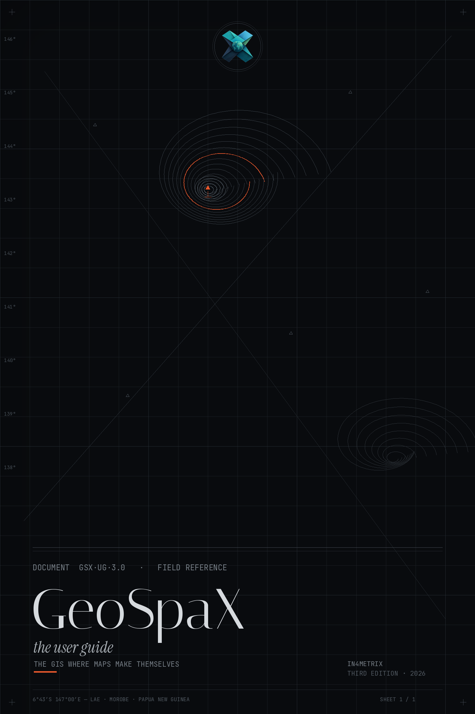</p>

GeoSpaX makes maps for you. You bring the data (plug something in, drop a file, or name an area) and a
**recipe** does the rest: import, analysis, styling, layout, legend and export to PNG, PDF and an HTML report.
This guide gets you from zero to a finished map in a few minutes.

- [1. Install](#1-install)
- [2. Your first map: four lazy ways](#2-your-first-map-four-lazy-ways)
- [2d. Guided tours: make every showcase map](#2d-guided-tours-make-every-showcase-map)
- [3. Where things go](#3-where-things-go)
- [4. Recipes in the box](#4-recipes-in-the-box)
- [5. Automation on and off](#5-automation-on-and-off)
- [5a. Edit and query data](#5a-edit-and-query-data)
- [6. Live sensors and phones](#6-live-sensors-and-phones)
- [7. Optional power tools: R, Python, GRASS, SAGA](#7-optional-power-tools-r-python-grass-saga)
- [8. Command line](#8-command-line)
- [9. Privacy](#9-privacy)
- [10. Troubleshooting](#10-troubleshooting)

## 1. Install

| You have | Do this |
|---|---|
| **Windows 10 or 11** (64-bit) | Run `GeoSpaX_3.0.8_x64-setup.exe`. It installs for you only, so no admin password is needed, and adds WebView2 if your PC lacks it (Windows 11 has it). Start **GeoSpaX** from the Start menu. **GeoSpaX Web Server** in the same menu opens the web edition in your browser. The installer isn't code-signed yet, so Windows may say "Windows protected your PC": click *More info → Run anyway*. Prefer no installer? Unzip `GeoSpaX-3.0.8-windows-x64.zip` anywhere and run `geospax.exe`. |
| **Any Linux** (AppImage) | Download `GeoSpaX-3.0.8-x86_64.AppImage`, make it executable (right-click › *Properties › Allow executing as program*, or `chmod +x GeoSpaX-*.AppImage`) and double-click it. Nothing is installed and no admin password is needed; it updates itself from inside the app. Works on distributions from 2024 onwards (Ubuntu 24.04, Fedora 40, Debian 13, Arch, openSUSE Tumbleweed …). |
| **Android** (field app) | Download `GeoSpaX-Field-<version>.apk` from the [download page](https://geospax.in4metrix.dev/#download), allow "install unknown apps" once and open it. Android 8 or newer. |
| **Docker** (any OS, web edition) | `mkdir -p data inbox && docker compose up -d`, then open the `http://localhost:8080/?token=…` link printed by `docker compose logs geospax` (set `GEOSPAX_TOKEN` to keep a fixed token). The compose file also starts an MQTT broker for live sensors. *The image is built by CI on version tags; it has not been built in our own test sandbox yet.* |
| macOS | Not packaged yet (it needs a Mac to build). Use the Docker web edition for now. |
| The source code | `scripts/setup-linux.sh`, then `cd web && npm ci && npx vite build`, then `cargo build --release -p geospax-server` and `./target/release/geospax-server --data data`. See the [README](../README.md). |

The AppImage, the Flatpak and the Windows installer all contain both editions (on Windows: `geospax.exe`, `geospax-server.exe`, and `geospax-web.cmd`, which starts the server on your `GeoSpaX` folders and opens the browser):

| Program | What it is |
|---|---|
| `geospax` | The desktop app. It also runs recipes from a terminal, e.g. `geospax run track-to-map --input source=~/tracks` (a folder or device). |
| `geospax-server` | The web edition. Run `geospax-server --data ~/GeoSpaX/Data`, then open <http://localhost:8080>. Only this computer can connect; to use it from other devices, add `--host 0.0.0.0` and open the link with the access token it prints ([SECURITY.md](../SECURITY.md)). |

## 2. Your first map: four lazy ways

**The quickest: drop a file, then Finish my map.**

1. **Start screen.** With nothing of your own on the map yet, GeoSpaX opens on **Make a map**: a big drop
   zone, the other ways in (plug in a device, send from your phone, start from an analysis) and **Your
   finished maps**. It comes back any time with **Add data** (Lazy task bar) or **Home → Start** (Pro).
2. **Drop your data** on the drop zone, or anywhere on the window, in either mode: GeoJSON, GeoPackage,
   a **zipped** shapefile, KML/KMZ, GPX, CSV with coordinates, FlatGeobuf, GeoParquet, GeoTIFF, LAS/LAZ.
   The file is saved in `Uploads/` in your data folder (never overwriting a file of the same name) and
   appears styled, zoomed to and selected. Point clouds wait for the *LiDAR → terrain* analysis.
3. **Finish my map** (Lazy task bar, or **Home → Finish my map** in Pro): give it a title (it suggests
   one) and press **Make the map**. The layers you see, styled as you see them, over the area you see
   (or all the data), are laid out with a title, legend with counts, scale bar, north arrow, graticule,
   a world underneath (Natural Earth land and borders) and credits, as a **PNG**, a print-ready vector
   **PDF** (and **SVG** if you want), with a **one-page report**. The report opens by itself; the files
   are in the run's folder and under **Your finished maps**. In Lazy mode the dialog asks only for the
   title (**More options**: subtitle, area, page size A4/A3/Letter, files); Pro shows them all.

**Layout** (in both Lazy and Pro) picks how the result is arranged:

| Layout | What you get | Like |
| --- | --- | --- |
| **One map** | Everything on one map | |
| **Side by side** | One page, each visible layer in its own panel, same area. With one layer: a single tagged figure panel | R patchwork `wrap_plots()` |
| **Split by a field** | One panel per value of a field (2–12 values, e.g. `kind`), same area and classes, one shared legend | ggplot2 `facet_wrap()` |
| **Panels** | Several areas on one page (a grid 1 × 1 to 4 × 4, or one per feature of a layer), each showing exactly its area | R patchwork |
| **Map series** | An index page with every sheet outlined, then one page per area, each exactly its sheet, bound into one PDF | ArcGIS Pro map series, QGIS atlas |

Panels are tagged (a), (b), … (or A, 1, i, or no tags) with a title each and their own scale bar; one
north arrow; **Columns** (automatic: a landscape page) and **Legend**: *one shared legend*
(patchwork's `guides = "collect"`), *one per panel*, or *automatic* (shared when every panel shows the
same layers, otherwise one per panel). Map series pages are files `title-01.png`, `title-02.png`, …,
the index `title-00-index`, and the bound `title-series.pdf`.

**Style** sets how the finished map looks. Start from a **look**, then change anything:

| Look | What it sets |
| --- | --- |
| **GeoSpaX** (default) | Pill scale bar, needle north arrow, legend beside the map, 150 dpi |
| **Journal** | 300 dpi, 4:3 page, legend inside the map, line scale bar, minimal arrow |
| **Poster** | 600 dpi, overview inset, rose, checker scale bar in km and miles |
| **Classic** | Compass and checker bar, 300 dpi |
| **Slide** | 16:9 page, legend inside, overview inset |

Under *Page, legend, scale bar, north arrow, inset* (open in Pro, one click away in Lazy):

- **Page shape**: automatic (fits the area), 1:1, 4:3, 3:2, 16:9, portrait 3:4 or 2:3, A4, A3, Letter.
- **Resolution**: 150, 300, 600 or 1200 dpi. The PNG is made at that resolution and carries it, so it
  opens at its print size in Word, InDesign or a journal's system; the PDF is vector at any size.
- **Legend**: beside the map, **inside the map** (on a card) or none, with its heading. **Edit the
  legend** lists every layer with its classes: untick to hide a layer, type a new title, rename any
  class, and drag a row (or ▲▼) to change the order.
- **Projection**: Automatic uses **Equal Earth** (equal-area: countries keep their true relative sizes)
  for world and continental maps and **Web Mercator** (as on the web map) for everything smaller; pick
  either yourself. A world map in Equal Earth has no single scale, so it gets no scale bar.
- **Scale bar**: pill, checker, line or ruler; km/m, mi/ft or both.
- **North arrow**: needle, compass, 8-point rose, minimal or none.
- **Overview inset**: a world/region map with your area boxed.

**Live preview.** The dialog shows the first page as it will be made, beside the options, and redraws
it as you change the layout, look, legend or furniture (a quick low-resolution render; nothing is saved
until you press **Make the map**).

On **multi-panel pages** a legend *inside the map* sits in each panel (one legend per panel) or in the
first panel (one shared legend); the north arrow and the overview inset go in the first panel.

**Furniture goes where your data isn't.** GeoSpaX looks at how much of the map's data falls in each
corner and puts the inside legend and the inset in the emptiest corners, the north arrow in the
emptiest top corner and the scale bar in the emptiest bottom corner. Pick a corner to pin any of them.

Behind the scenes Finish my map is an ordinary recipe, `finished-map`, replaced each time: it has run
history and provenance, and you can re-run it or give it a trigger like any other.

**The layout window: the page beside your map.** **Share → Layout window** (or **Open in layout window** in
Finish my map) opens the map page in a window of its own, like ArcGIS Pro's layout view or QGIS's print
layout. Move it to a second monitor or press **F** for full screen. Scroll to zoom (the page is vector, so it
stays sharp), drag to move, double-click or **0** to fit, **1** for actual size. While **Live** is on it
redraws whenever you pan the map, switch a layer on or off or change a style, using the choices last made
in Finish my map (title, layout, style, furniture). **Make final files** writes the PNG, the vector PDF, the
SVG and the report, as a web page and as a **Word document (report.docx)** you can edit; the links appear
under the toolbar and in the report.

**Opening the app is already lazy.** Every layer GeoSpaX sees for the first time is styled by AutoMap,
the same engine the recipes use: it picks the field that matters (never an ID), the classification and a
colour-blind-safe colour scheme, and the Symbology pane says why ("✨ Styled automatically …"). Change
anything and the style is yours; **✨ Style automatically** brings AutoMap back. Layers too dense to draw
zoomed out get their overview pyramid built in the background, one at a time, without a click. The map
opens on your data over an offline world basemap (Natural Earth land, lakes and borders); **View →
Basemap** switches to OpenStreetMap (online) or none. Add `?auto=0` or `?autooverviews=0` to the address
to turn either automation off.

**a) Drop files into `~/GeoSpaX/Inbox`.** Photos, GPX/KML/NMEA tracks, drone logs and sensor logs dropped here
are mapped by the matching recipe within about 5 seconds, with no switches to turn on:

| Device content | Recipe that runs | You get |
|---|---|---|
| Geotagged photos (phone, camera, folder) | `photos-to-map` | Photo points and tracks on a laid-out map, plus a report |
| GPS tracks or waypoints | `track-to-map` | Track map, KML and GeoJSON |
| Drone card (DJI photos and SRT logs) | `drone-flight-report` | Coverage map and flight report |
| Sensor logger CSV/JSON | `sensor-log-to-map` | Readings map (air quality is classed by the WHO guideline) and a summary |

**b) Plug something in.** Connect a phone (file transfer mode), a GPS unit, a camera or drone SD card, a sports
watch or an air-quality logger. GeoSpaX lists it in the **Devices** section within about 5 seconds. Press
**Import & map** once. To have it mapped on every plug-in, turn on the matching recipe's **Auto** switch in
**Automate**. Devices are never processed without a click or a switch, because photo locations and tracks are
personal data.

**c) Send from your phone over Wi-Fi.** No cable and no app needed:
1. In the **Devices** section, press **Send from phone → Turn on** and scan the QR code with the phone's camera.
2. The phone shows a certificate warning once. That certificate belongs to your own computer: choose *Advanced → Continue*.
3. Then **Choose files** (photos, tracks, sensor logs) or **Take a photo**.

The map makes itself, on the computer and on the phone. Photos that lost their location on the way are placed on
the phone's track by their time, if **Share live location** was on while you took them. Photos taken with **Take a
photo** always get the phone's position. Works on Android and iPhone, with Windows, macOS and Linux.

**d) Pick a recipe and press Run.** Open the **Automate** section, choose a recipe (for example *Terrain report*
or *Latest cloud-free NDVI*), answer the one or two questions it asks (usually just the area) and press **Run**.
The autopilot fills in every other setting and explains its choices in the report.

Finished maps appear in the **Automate** section under the recipe's runs. Open one to see the map, the PDF and the
report.

## 2b. The workbench: ribbon, panes, map

**Where things are:** the left panel has **Project**, **Explorer** (folders, online data, and
**Devices & phones** at the bottom) and **Contents** (every layer and raster on the map). The right
panel has **Layer** (the selected layer's style; with nothing selected, the map itself: basemap,
globe or flat, 3D, bookmarks), **Tools** (the Toolbox) and **Ask**. Under the map: **Attributes**
(the selected layer's table), **Automate**, **History** and **Log** (Lazy: **Activity**).

GeoSpaX opens like a desktop GIS: a **ribbon** on top, **panes** docked around the map, and a **status bar**
underneath. Nothing is hidden behind a menu you have to hunt for — and every button still runs the same engine
calls the recipes use.

**Lazy or Pro: GeoSpaX fits you.** One switch in the title bar (remembered in your browser; Lazy is the
default) changes the ribbon and the layer list together:

- **Lazy: the task bar.** The ribbon becomes one slim row: a **What do you want to do?** box (type anything:
  "hot spots", "export", a layer name), tasks in plain words (**Add data**, **Online data**, **Make it look
  good**, **Find patterns**, **All tools**, **Finish my map**) and **Next for <layer>**: the analyses that
  fit the layer you selected, one click to run them on it.
- **Pro: the full ribbon**, in the order you work, plus a contextual **Layer** tab while a layer is
  selected (zoom, attribute table, symbology, AutoMap and the same next steps):

  | Tab | Groups |
  | --- | --- |
  | **Home** | Project · Layer (add data, basemap, contents, zoom to layer) · Navigate (previous/next extent, go to XY, bookmarks) · Selection (by attributes, by location, lasso) · Inquiry (identify, find place, measure, coordinates) · Symbology (labels, AutoMap, legend) |
  | **View** | Basemap · Projection (coordinate system, Mercator, globe, 3D terrain) · Compare (swipe, spyglass) · Time (time slider) · Map grid (grid, go to scale, lock scale) · Theme · Windows |
  | **Edit** | Create (point, line, polygon, trace, GPS point) · Modify (split, merge, cut, reshape) · Clipboard (copy, paste, copy along line) · Selection · Fields (attribute rules) · Measure · Manage edits (save, undo, discard, check topology) |
  | **Design** | Precision (snapping, typed input) · Draw · Construct · Modify (hatch and the CAD edits) · Blocks · Survey (traverse, survey points, area table) · CAD exchange (DXF, copy and paste features) |
  | **Imagery** | Rasters · Indices · Satellite (latest NDVI) · Satellite embeddings · Terrain · LiDAR · Raster tools (clip, mosaic, reproject, resample, change) · AI models |
  | **Analysis** | Geoprocessing · Recipes · Tools (buffer, clip, intersect, union, dissolve, merge, spatial join, near, summarize within, erase, zonal statistics) · Network · Spatial statistics · Interpolation · Assistant |
  | **Share** | Layout (Finish my map) · Export map · Export data · Export · Publish (web map, package project, print) |
  | **Help** | Learn (tutorials, search commands) · Docs (user guide, FAQ, what's new) · Support · About · Diagnostics |

  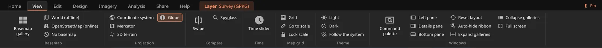

  *A tab at a glance (View shown): large buttons for the common action of each group, small
  three-a-column buttons for the rest, and split buttons — like **Basemap** here — that run the last
  choice and open the list on their arrow.*

  **Data, R & Python, recipes and plugins are in the Explorer** (left panel), not on the ribbon:
  **Online data** (climate, future climate, soil, species, boundaries, elevation … and Check species
  names), **Overture Maps**, **Recipes** (with the recipe gallery) and **Results**, **R & Python** (R:
  packages, R console, tmap, ggplot2 and rayshader maps, terra terrain, Earth Engine, biomod2 and MaxEnt,
  tidymodels, dbplyr, see [R.md](R.md); Python: environments and Python steps), **AI models**,
  **Plugins** (Manage plugins…, then each plugin), **Sample data** and **Devices & phones**. Every
  one of these is also in **Ctrl+K**.

  The tabs follow the order work goes: open and look at the map (Home, View), make and prepare data (Edit, Design, Imagery), analyse it (Analysis), then hand it on (Share); groups inside a tab follow the same rule. When the window is too narrow for a tab, its rightmost groups fold
  into **▾** menus instead of being cut off. **Settings** (Home tab, or the ⚙ at the top right) keeps theme,
  mode, units, basemap and automation choices. **Help** opens the guides and the FAQ as a searchable web page
  of its own (a new browser tab, or a window on the desktop).

  Every group has the same height: its main commands are large buttons, the others small buttons stacked
  three to a column, as in ArcGIS Pro. A plugin tool appears on the tab its manifest names
  ([PLUGINS.md](PLUGINS.md)).

**Online data** (Explorer › Online data, or the Lazy task) gets free data for the area on the map, with no account:
WorldClim 2.1 bioclim and monthly climate, WorldClim CMIP6 future climate (12 models, four SSPs, four
periods), CHELSA 2.1, SoilGrids 2.0, GBIF / OBIS / iNaturalist occurrences, GADM boundaries, the
Copernicus DEM, **ocean depth** (GEBCO 2026: sea depth and land height in one surface, drawn with sea level
as the coastline, and how each depth was measured), **forest change** (Hansen Global Forest Change v1.13:
tree cover in 2000 and the year of loss 2001–2025 at 30 m, for areas up to about 220 km a side) and
**ecoregions** (RESOLVE 2017, the updated WWF terrestrial ecoregions, in their published colours). Only the area is downloaded (climate keeps the provider's own grid), each result becomes a
layer, and its citation goes into the run's methods and report. It is a recipe step, `data.fetch`, so a
recipe can fetch data on a schedule too ([AUTOMATION.md](AUTOMATION.md)).

**Check species names** (Explorer › Online data) matches a layer's scientific names against the World Register of
Marine Species (WoRMS). You get a copy of the layer with each name's AphiaID, its status, the accepted
name for synonyms (*Acropora formosa* → *Acropora muricata*), the classification, the habitat and a
verdict to review: *ok*, *synonym*, *check spelling* (a fuzzy match, e.g. *Chelonia mydass*),
*ambiguous* (a name shared by two groups: *Acropora* is a coral and an old bryozoan genus; *Only within
Cnidaria* settles it) or *not in WoRMS*. Your own names are never changed. WoRMS covers marine taxa
best; many freshwater and land species are not in it. Answers are kept for 30 days, so a re-run does not
ask WoRMS again.

The side and bottom panes follow it too:

- **Lazy, right: the Inspector.** The selected layer as a short story: what it shows (with a bar per class
  and its count), *why* it looks like that, **Colour it by** (one chip per useful column, plus *Let GeoSpaX
  choose* and *One colour*), a see-through slider, **Do something with it** (the analyses that fit, zoom,
  see the rows) and **Where it came from** (file, format, extent, columns).
- **Lazy, bottom: Activity.** *Ideas for your data* (the analyses that fit the layers on the map, one click
  each) and *What happened* (every run, including the ones devices start by themselves, with **Open
  report**, then the latest notes).
- **Pro** keeps Symbology, Attributes, Rasters, Devices on the right and Automate, Plugins, History, Log at
  the bottom.

The layer list follows the same switch:

| | Lazy: layer cards | Pro: layer tree |
|---|---|---|
| Name | Friendly ("Air quality samples") | File name (`air_quality_samples.geojson`) |
| What it shows | One sentence from the data: "Coloured by PM2.5 against the WHO guideline: 88% of 1,500 readings are above 15." | Geometry · CRS · zoom range · classification on one line |
| Legend | A bar whose segments are as wide as their share of the features | Classes with counts |
| Status | Ready · Styled for you · Preparing zoomed-out view (with progress) · Hidden | Compact badges (pyramid %, auto) |
| Next step | Buttons for the recipes that fit this layer (Make a surface, Hot spots, Hexagon map), run on *this* layer | Ribbon and palette |
| Arranging | Grouped by origin: from your devices, your data, recipe results, reference, background | Drag rows to reorder, inline opacity, filter box |

Both show the same project: switching never changes the map.

```
┌──────────────────────────────────────────────────────────────────────┐
│ GeoSpaX   ⤓ ⟳ ⤢ ⌘                          Ctrl+K for any command    │  title bar
│ Home  View  Edit  Design  Imagery  Analysis  Share  Help            │  ribbon tabs
│ ┌ Refresh ┐ ┌ Contents ┐ ┌ Attribute ┐ ┌ Export ┐                     │  ribbon body
│ └──Project┘ └── Layers ┘ └──Selection┘ └──  Map ┘                     │
├────────────┬──────────────────────────────────┬───────────────────────┤
│ Contents   │                                  │ Symbology             │
│  ☐ layer   │            M A P                │ Attributes            │  ← drag the
│ Explorer   │                                  │ Rasters               │    splitters
│ Project    ├──────────────────────────────────┤ Devices               │
│            │ Automate │ History │ Log         │                       │
├────────────┴──────────────────────────────────┴───────────────────────┤
│ Ready   -5.86234, 144.23451   1:18,000 · z14.0    countries · 258      │  status bar
└──────────────────────────────────────────────────────────────────────┘
```

| Where | What it does |
| --- | --- |
| **Ribbon** | Eight tabs of commands, in the order of the work (Home, View, Edit, Design, Imagery, Analysis, Share, Help; data sources, R & Python, recipes and plugins live in the **Explorer**) with icons, tooltips and shortcuts. **Analysis** carries the recipes as a single dropdown button (`Recipes 10 ▾`) — click it for the list, click a row to run it; the small button in the group title expands it to a card gallery instead. The **pin** at the right of the tab strip (or `Ctrl+F1`) auto-hides the whole ribbon: click a tab to use it, and it closes itself afterwards (about 80px more map). |
| **Contents** (left) | The layer list: visibility, draw order, legend, symbology. Rasters are listed with the vector layers. Every result of an analysis (a recipe, a Toolbox tool, the Ask assistant, a trigger) is added here by itself, switched on and on top, as in ArcGIS Pro and QGIS; drag it or use ▲ ▼ to change what draws over what. |
| **Explorer** (left) | Your files on disk, as ArcGIS Pro's Catalog, QGIS's Browser and VS Code's Explorer: **Folders** lists the data folders, your **folder connections** (**Connect a folder…** at the top, **Data › Connect folder** or right-click: pick any folder of this computer; it is kept for the next start and ✕ removes it, the folder itself is never touched) (and *Edits*, the copies of layers you edited) with every map file in them; double-click a file or press **+** to add it to the map, a ✓ marks files already on it, right-click for *Add*, *Copy path* and *Refresh*. **On the map** lists the layers by the file they come from (click one to make it active); **More** opens sample data, recipes, devices, rasters and run history. Only the data folders can be browsed, never the rest of the computer. |
| **Project** (left) | Your map as a whole: where it is saved (it saves itself after every change), its layers, basemap, projection and view; **Save a copy…** downloads it as a file to keep or share, **Open…** reads one back (also a 1.4.2 `.gspx` or a 2.0 `.geolibre.json`, whose layers are imported), **New** starts again. **Bookmarks** remember map views by name (also *View › Bookmark view*). The data stays in your files; the project only points at them. Developer controls (tile transport, engine cache, benchmark, Arrow → deck.gl) are folded away under *Diagnostics*, also opened by *Help › Engine diagnostics*. |
| **Symbology** (right) | Renderer, field, ramp; point shape and size (fixed or by a field), line width, dash and casing, polygon fill and outline, opacity; labels (font, size, halo, placement, wrap) — for the active layer. Rasters: ⚙ on the raster opens its own Symbology (stretch, classes, split, RGB, band, ramp, range presets, invert, resampling, opacity, Reset to automatic). |
| **Attributes** (right) | The table: 250 rows at a time, click a row to zoom to that feature, `Ctrl+click` to select several, plus **Fields** and **Chart** views. |
| **Rasters / Devices** (right) | DEMs, hillshades, indices; phones, GPS units, SD cards, live sensors. |
| **Automate / History / Log** (bottom) | Recipe gallery with Auto switches; every run with its artifacts; a running log. |
| **Status bar** | Cursor coordinates, scale ratio and zoom, the active layer, and what the last command did. |

**Getting around**

| Key / gesture | Result |
| --- | --- |
| `Ctrl+K` | Command palette: search every command, recipe and layer; `↑↓` to move, `Enter` to run |
| `F5` · `Ctrl+S` | Refresh layers · save the project |
| `Ctrl+1` · `Ctrl+2` | AutoMap the active layer · open Symbology |
| `Ctrl+T` · `Ctrl+0` | Attribute table · zoom to everything |
| `Z` · `+` · `-` | Zoom to layer · in · out |
| drag a splitter | Resize a pane (double-click to reset) |
| double-click a pane tab | Collapse the pane to a 30 px strip of vertical tabs (double-click again to reopen) |
| click a feature | Identify: its attributes in a popup |

Pane sizes, which tab is open and which panes are collapsed are remembered per browser/app.

### The ribbon tools, tab by tab


Every panel (left, right and bottom) has a chevron at the end of its tab strip that folds it away and brings
it back, so the map can take the whole window when you need it.

- **Home**: **Lasso** selects features inside a shape you draw. **Labels** turns the selected layer's labels
  on and off. **Coordinates** shows the pointer position in decimal degrees, degrees-minutes-seconds, UTM,
  MGRS or any EPSG system you pick.
- **View**: **Swipe** shows the map with the selected layer on one side of a divider and without it on the
  other; drag the divider to compare. **Spyglass** does the same inside a circle that follows the pointer.
  **Time slider** plays a layer that has a date or year field, by year, month or day, or adding up as it
  goes. It works through a definition query, so tools and exports see the same features as the map.
  **Grid** draws a labelled graticule. **Go to scale** zooms to a scale such as 1:50 000 and **Lock scale** keeps it while you pan.
  **Coordinate system** searches the EPSG registry, with the systems for the area on the map first. With the search box empty, a **Pacific pack** comes first: PNG94 and PNGMG94 zones 54 to 56, AGD66, the Fiji Map Grid, UTM zones for the Solomon Islands, Vanuatu, Samoa and Tonga, NZTM, MGA 55 and the Pacific-centred PDC Mercator.
- **Edit**: **Split**, **Merge**, **Cut** and **Reshape** change shapes and keep their attributes, and each
  one can be undone. **Copy** and **Paste** (Ctrl+C and Ctrl+V) move features between layers; **Copy along
  line** places copies of the selected feature at equal steps along a line. **Trace** makes new edges follow existing features between snapped vertices.
  **GPS point** adds a point at the live position of a paired phone or GNSS receiver. **Attribute rules**
  set value lists, defaults and required fields. **Check topology** finds overlaps, gaps and invalid shapes
  and adds them as a layer.
- **Design**: **Survey points** reads a CSV of points in any EPSG system. **Area table** lists the geodesic
  area and perimeter of each shape and saves it as CSV. **Hatch** gives the selected polygon layer a fill pattern.
  **Copy features** and **Paste features** move shapes between GIS layers and drawings.
- **Imagery**: **Indices** makes a spectral index (or any normalised difference) and finds its extent with
  Otsu's threshold. **Terrain** makes a hillshade, slope, aspect, ruggedness, wetness index, viewshed or
  elevation profile from a DEM. **Raster tools** clip, mosaic, reproject, resample and compare rasters.
- **Analysis**: every button in **Tools** opens its tool directly. **Erase** removes the parts of one layer
  that fall inside another. **Zonal statistics** weights each cell by the share of it inside the polygon,
  so thin and small polygons get correct values. **Network** finds service areas, the closest facility and
  the shortest path over a road layer.
- **Share**: **Export map** saves PDF, SVG, PNG or a Word report. **Export data** saves GeoPackage,
  Shapefile, KML, CSV, GeoJSON, GeoParquet or PMTiles. GeoParquet files carry a per-row `bbox` covering
  column (GeoParquet 1.1) in 65,536-row groups, so DuckDB, GDAL and GeoSpaX read only the parts of a big
  file that cover the area asked for. PMTiles writes the layer as one vector tile archive (zoom 0 to 14,
  lowered for very large areas) that MapLibre or any static web host can serve with no tile server. **Web map** writes an interactive map in a single HTML file
  (layer switches, legend and pop-ups) that opens in any browser or web host. **Package project** saves a
  `.gspx` file that **Open…** reads back. **Print** prints the map.
- **Help**: **Tutorials** are guided lessons on the real window. **Search commands** finds any command by
  name.

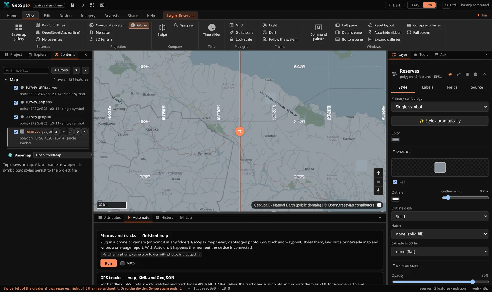

*Swipe: core forest on one side of the divider, the imagery underneath on the other, to check the result against the ground.*

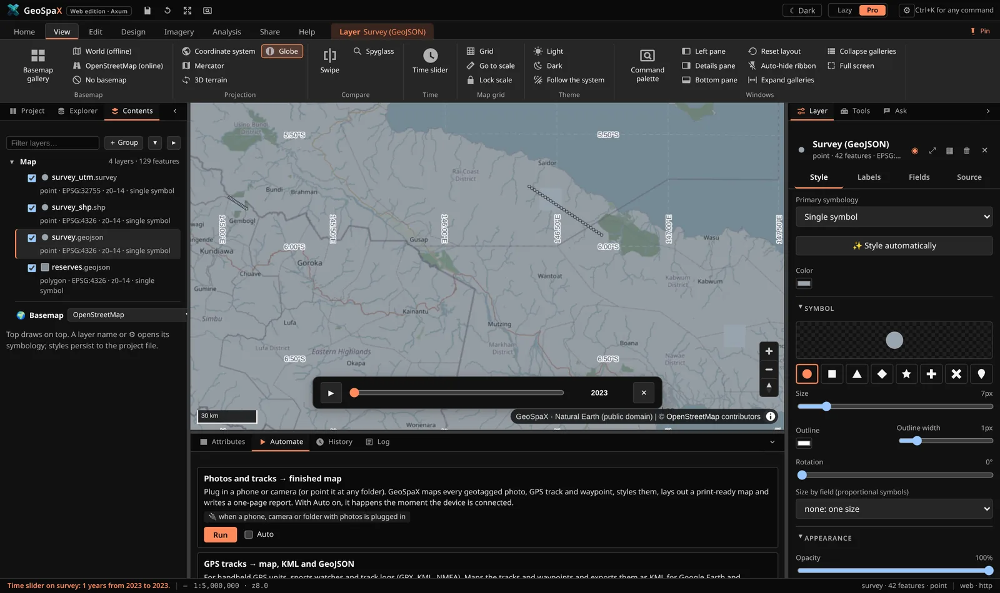

*Time slider: 2,000 GBIF bird records from 1993 to 2026 building up year by year, shown here at 2019.*

### The Toolbox: every tool in one place

The **Tools** tab (right pane, both modes; **All tools** in the Lazy task bar, **Analysis → Toolbox** in
Pro) lists every tool GeoSpaX can run, with one search box:

- **Ready-made analyses**: the recipes. A form, then **▶ Run**: the result joins the map, with a laid-out
  map and a report under Activity / History. They come first in search results.
- **Building blocks**: the engine's 36 recipe steps. Each shows the tools it stands in for in ArcGIS Pro,
  QGIS, GRASS, SAGA and others (*≈ ArcGIS Buffer, QGIS Buffer, GRASS v.buffer…*), so typing the name you
  know finds the GeoSpaX way, and which ready-made analyses use it.
- **GeoLibre tools**: 1,062 raster, vector, LiDAR, hydrology, terrain and conversion tools (below).
- **Plugin tools** from GeoSpaX, RustGIS, QGIS and ArcGIS Pro plugins, each with a badge saying where it
  comes from.

Recently used tools stay at the top. A tool's page shows what it does and its parameters; **Open the
tool…** opens its form. Whatever a tool writes is added to the map.

### The layer tree (Pro)

Pro mode's Contents is a tree, as in ArcGIS Pro: **Map** ▸ group layers ▸ layers ▸ legend classes, then the
basemap. **＋ Group** puts the selected layer in a new group; drag a layer onto a group to add it, onto
**Map** to take it out, onto another layer to take its place. A group's switch hides all its layers
without changing their own switches; the twisty (▾/▸) folds a layer's legend; ✎ renames a group
(or double-click its name) and ⊟ ungroups it, keeping the layers. Groups are saved in the project.

**Keyboard in the Pro tree.** Tab into the layer tree (one tab stop), then ↑/↓ move, Home/End jump,
→/← expand or collapse a group or a legend (← on a layer in a group goes to the group), Space shows or
hides, Enter opens the symbology, Alt+↑/↓ moves the layer in the drawing order, F2 renames a group.

**Theme.** GeoSpaX opens in a light theme. The button left of the Lazy/Pro switch cycles ☀ Light → ☾ Dark →
◐ System (follows your operating system); View → Theme does the same. The choice is remembered; add
`?theme=dark` to a link to force one. The map's background and land colours follow the theme.

## 2c. Plugins: tools from five ecosystems

Plugins are in the **Explorer** under **Plugins**. **Manage plugins…** (first row) lists what is
installed, the runtimes found, and imports, reloads or uninstalls plugins; the plugins' own tools are
in the **Tools** tab, and on a ribbon tab when a plugin names one (`tab:`). Every plugin is a
folder with a manifest, and GeoSpaX reads five formats, so a tool written for another GIS shows up
here:

| Written for | File it looks for | What runs |
| --- | --- | --- |
| GeoSpaX | `plugin.yaml` | `process`, `python`, `r`, `wasm`, `recipe` tools |
| RustGIS (`.rgplugin`) | `plugin.json` + `plugin.wasm` | the WASM module, through `wasmtime`/`wasm3`/`deno` |
| GeoLibre | `plugin.json`, WASM tool bundles | its tools (WASI); its React UI cannot run here |
| QGIS | `metadata.txt` | its **processing algorithms** through `qgis_process`; its PyQt UI cannot run here |
| ArcGIS Pro (`.esriAddInX`) | `Config.daml` (+ `Toolboxes/*.pyt`) | its **Python toolbox** tools through arcpy; the .NET assembly cannot run here |

**GeoLibre tools come with GeoSpaX.** The `geolibre-tools` plugin brings GeoLibre's whole tool runner
(geolibre-wasm, built on whitebox_next_gen): 1,062 tools, run locally on WebAssembly. They need
[Node.js](https://nodejs.org) 18 or newer; the runner (about 9 MB) is downloaded once on first use and
checked against its published checksum. A vector parameter is a layer on the map; raster, LiDAR and
table parameters take a file path; results are added to the map. Offline machines: see
`plugins/geolibre-tools/README.md`.

**Removing one:** **Uninstall** on the card (press it twice). Plugins that live in a folder you
started the server with (`--plugins DIR`) are not deletable from here — the card says "external
folder" so you can remove them yourself.

**In the ribbon:** recipes and plugin tools are collapsed into a single button with a count
(`Recipes 10 ▾`) so the ribbon stays one row tall. Click it for the full list — icon, title and one
line of description, one click to run. The tiny button in the group's title switches that group back
to a card gallery, and the choice is remembered.

The twelve domain plugins ship with GeoSpaX — what each one made on open data around Lae (see the
step-by-step table in [§2d · The twelve domain plugins](#the-twelve-domain-plugins)):

<table><tr>
<td>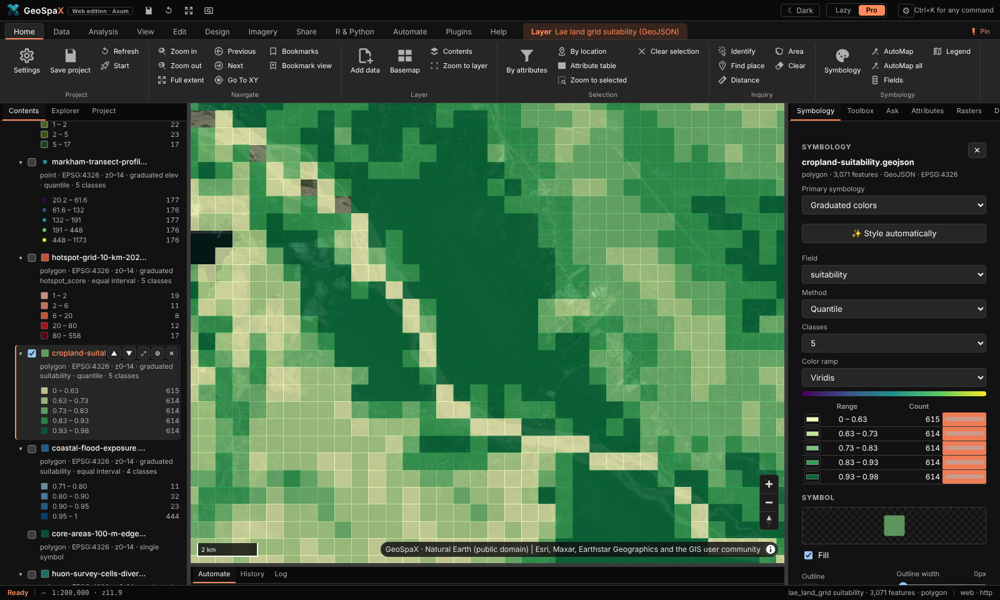</td>
<td>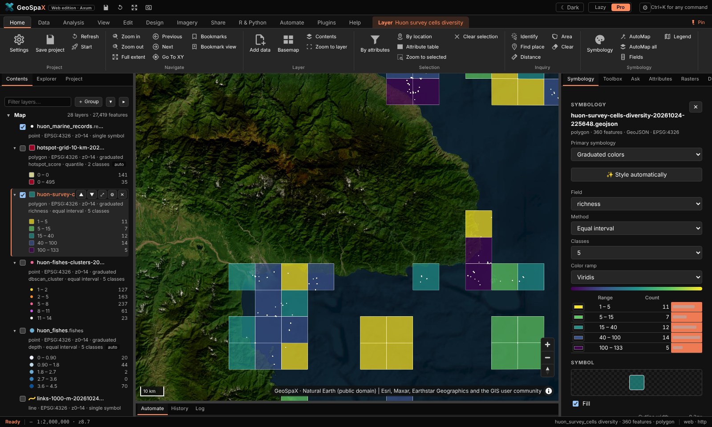</td>
<td>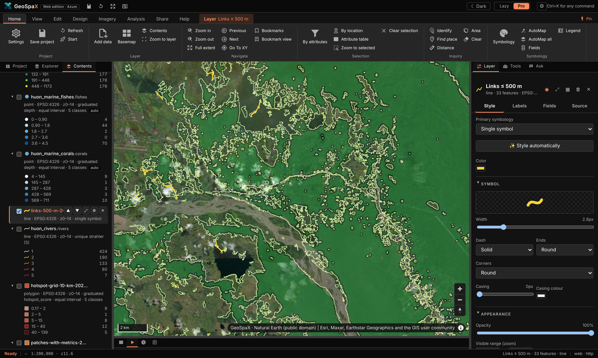</td>
<td>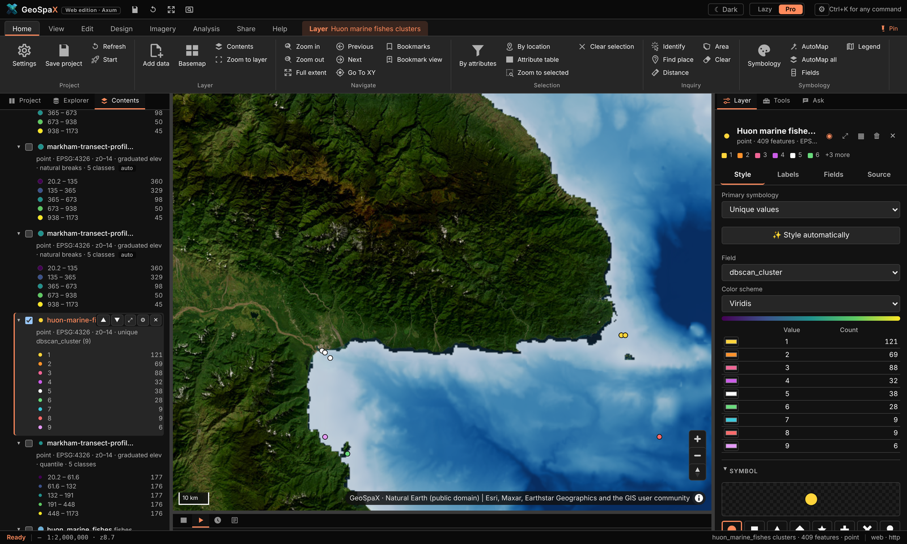</td>
</tr></table>

*Cropland suitability · species richness per cell · forest fragmentation · DBSCAN fish clusters —
four of the twelve domain plugins, all run inside GeoSpaX on open data.*

### What running a tool looks like

Every plugin tool opens the same kind of form: a plain-words description on top, labelled fields
(layer pickers list what is on your map, required fields are marked), then **Cancel / Run**. Pick a
layer, adjust the defaults if you like, press **Run** — results land on the map and in **History**.

<table>
<tr>
<td>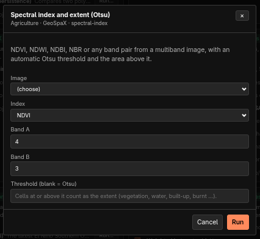<br /><b>Spectral index (Otsu)</b><br />band pair + threshold → NDVI/NDWI/NBR extent</td>
<td>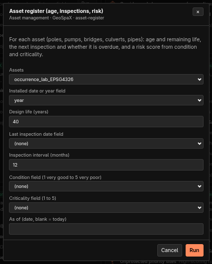<br /><b>Asset register</b><br />age, inspections and risk per asset</td>
<td>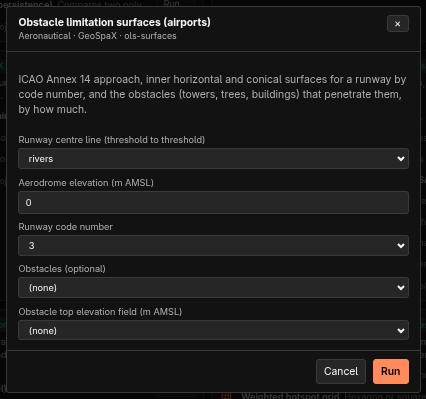<br /><b>Obstacle limitation surfaces</b><br />ICAO Annex 14 surfaces + obstacles</td>
</tr>
<tr>
<td>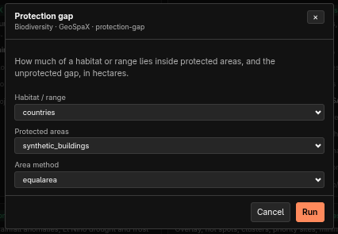<br /><b>Protection gap</b><br />habitat inside vs outside protected areas</td>
<td>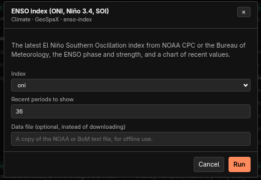<br /><b>ENSO index</b><br />latest ONI / Niño 3.4 / SOI + chart</td>
<td>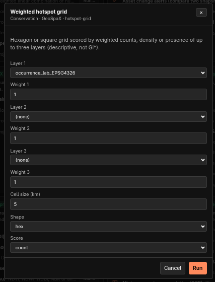<br /><b>Weighted hotspot grid</b><br />up to 3 layers on hex/square cells</td>
</tr>
<tr>
<td>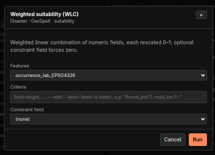<br /><b>Weighted suitability (WLC)</b><br />field:weight criteria rescaled 0–1</td>
<td>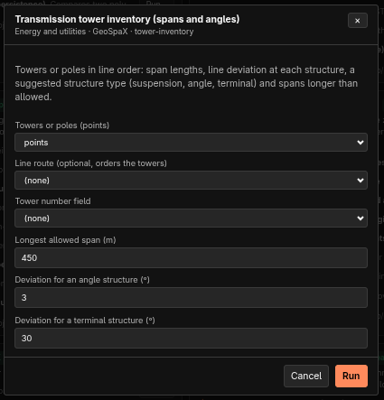<br /><b>Tower inventory</b><br />spans, deviations, structure types</td>
<td>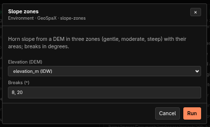<br /><b>Slope zones</b><br />gentle / moderate / steep + areas</td>
</tr>
<tr>
<td>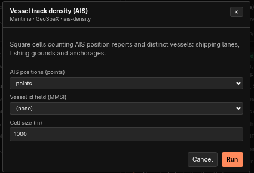<br /><b>Vessel track density</b><br />AIS reports + distinct vessels per cell</td>
<td>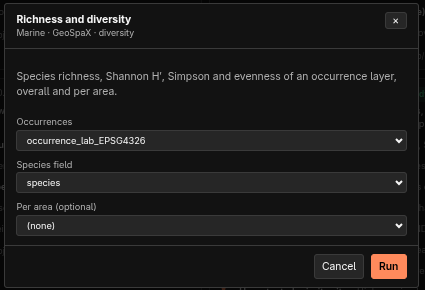<br /><b>Richness and diversity</b><br />richness, Shannon, Simpson, evenness</td>
<td>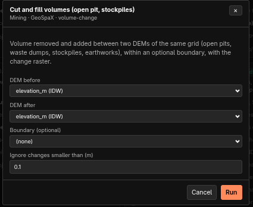<br /><b>Cut and fill volumes</b><br />volume removed/added between DEMs</td>
</tr>
</table>

*All fields come with sensible defaults (e.g. bands 4/3 for NDVI, 40-year design life, 10 m / 1 km
cells); `(none)` and `(choose)` mean the field is optional or needs a pick. A blank text field uses
the tool's own choice — Otsu threshold, today's date, auto CRS.*

**Using one:** click a tool's **Run…**, fill in the form, press Run. The result (or the recipe run it
started) is reported in the pane and in the log; recipe-backed tools also appear in **History**.

**Installing:** paste a folder or package path (`.rgplugin`, `.esriAddInX`, `.zip`) into the box at
the top of the pane, or `geospax-server plugins import PATH` on the command line. Plugins are stored
in `<state>/.geospax/plugins`; `--plugins DIR` adds a folder you are developing in.

**Writing one:** copy `plugins/example-python` — a `plugin.yaml` with tools and parameters, plus a
script that reads a JSON request on stdin and prints JSON back. Full contract, runtimes and the
honest compatibility table: [PLUGINS.md](PLUGINS.md).

## 2d. Guided tours: make every showcase map

Every picture in the README and on the site was made inside GeoSpaX on open data. This section walks
through each one, step by step, so you can make it yourself — then take it apart and make it yours.
All of it runs offline except where a tour says it fetches data (DEM, imagery, species records).

The tours use the **Pro** interface. Press the **Pro** button (top right) if you are in Lazy mode —
same map, same engine, more controls. Ribbon paths are written **Tab › Button**; panels are
**left › Explorer** (files, online data, recipes, plugins, devices) and **right › Layer / Tools / Ask**.

### The starting globe

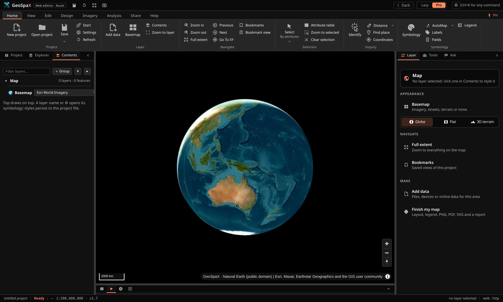

**What it is:** the app as it opens — Esri World Imagery on a globe, no layers yet, the Layer tab on
the right offering basemap, projection and data choices.

**Make it:**

1. Start GeoSpaX. It opens here every time with a fresh project.
2. Nothing selected = the **Layer** tab (right) controls the map itself:
   - **Basemap** — imagery, streets, terrain or none;
   - **Globe / Flat / 3D terrain** — the projection;
   - **Add data** — your files, devices and online sources.
3. Turn it flat with **View › Mercator**, back to a ball with **View › Globe**. The two buttons stay
   pressed to show which is on.

**Try next:** click the imagery — nothing is there yet. That is what the next tours fix.

### Lazy mode: layer cards that explain themselves

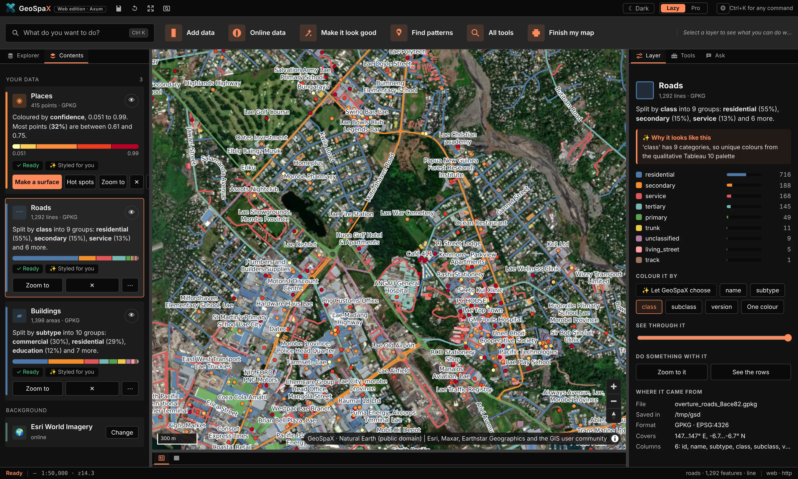

**What it is:** the same project in **Lazy** mode — one card per layer saying what it shows
("Coloured by *height*, 3 to 30"), a legend bar, and one-click next steps under it
(*Make a surface*, *Hot spots*, *Zoom to*).

**Make it:**

1. Press **Lazy** (top right). The ribbon becomes a task bar.
2. Drop a file on the window (or use the sample data below). The card appears styled and zoomed to.
3. Read the card: the field it chose, the classes, and *why* under "Styled for you".
4. Press a next step on the card — each runs the real tool, not a demo. **Hot spots** on a point
   layer, for example, runs Getis-Ord Gi* with settings chosen from the data.

**The sample data used here:** `data/` in this repository (Natural Earth countries, rivers, roads
and places; a GBIF occurrence file; 1 M synthetic points, buildings and hotspots). Any GeoJSON,
GeoPackage, zipped Shapefile, KML, GPX, CSV, GeoTIFF, FlatGeobuf, GeoParquet or LAS/LAZ works the
same way.

Raster results (tool outputs, terrain products and STAC downloads cut to an area) are written as
cloud-optimised GeoTIFFs (COG): tiled, DEFLATE-compressed and with internal overviews, so they open fast
and can be put on any web host and streamed. Set `GEOSPAX_RASTER_COG=0` to write plain tiled GeoTIFFs.

### Pro mode: the full workbench

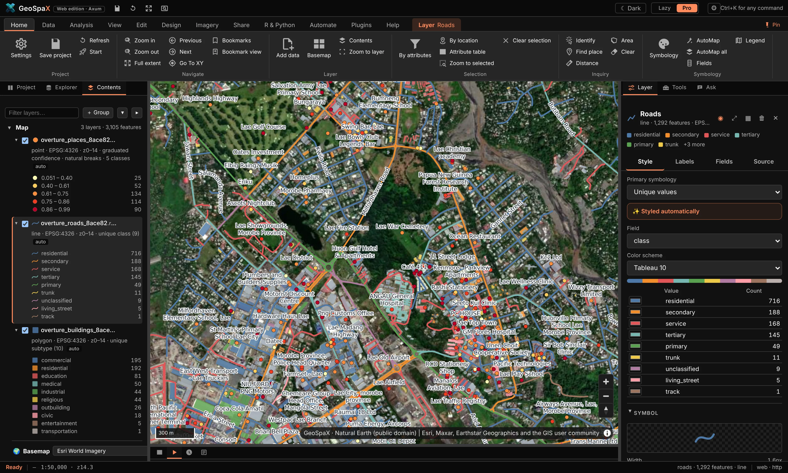

**What it is:** the ArcGIS-Pro-style workbench — ribbon on top, **Contents** tree on the left with
live legends and feature counts, **Layer / Tools / Ask** tabs on the right, attribute table and
runs underneath.

**Make it:**

1. Press **Pro**. The ribbon appears (Home, View, Edit, Design, Imagery, Analysis, Share, Help).
2. The **Contents** pane (left) lists every layer: twisty to expand its legend classes, the number
   of features, and flags like `overviews suggested`.
3. Click a layer name — the right **Layer** tab becomes *its* panel: appearance, labels, fields,
   source. This is where styling lives.
4. The **Tools** tab is the Toolbox (~1,130 tools); **Ask** is the assistant.
5. The bottom dock holds **Attributes** (the table) and **Automate / History / Log**.

**Ribbon tour, the useful stops:** **Home** has add data, selection, identify and measure;
**View** has swipe, spyglass, time slider, grid, projection and theme; **Edit** has drawing and
attribute editing; **Design** is CAD; **Imagery** is rasters, terrain and remote sensing;
**Analysis** is the Toolbox, network and statistics; **Share** is export and publish; **Help** is
docs, tutorials and diagnostics.

### Swipe: a layer on one side of the divider


**What it is:** **View › Swipe** draws the *selected* layer only on one side of a vertical divider
you drag. The other side shows the map without it — for before/after or layer/basemap comparison.
**Spyglass** (next to it) is the same idea inside a circle that follows the pointer.

**Make it:**

1. Load two things that overlap — e.g. drop `natural_earth.roads` on top of imagery, or open
   *Explorer › Online data › Boundaries* for a country boundary over the basemap.
2. Click the layer in **Contents** so it is selected (it is what swipe hides).
3. **View › Swipe**. The button stays pressed; a divider appears.
4. Drag the divider. Left of it: the layer. Right of it: everything else.
5. Optional: **View › Grid** for the labelled graticule shown in the shot.
6. Done: click **Swipe** again (or press Esc) to release it.

### Time slider: play a layer through its dates


**What it is:** **View › Time** shows a layer one period at a time (or accumulating) by any date or
year field — through a definition query, so tools, exports and selections see the same features as
the map.

**Make it:**

1. You need a layer with a date-ish field. The occurrence sample
   (`lab_paradisaea_guilielmi_occurrences.geojson`) has `year`; GPS tracks have timestamps.
2. Select the layer in **Contents**.
3. **View › Time**. Pick the field and the step — year, month or day.
4. Press **play** or drag the slider. The map shows that period only; the **Attributes** table and
   any export see the same subset.
5. Toggle **accumulate** to keep earlier periods on screen instead of replacing them.
6. **Time** again (or Esc) ends it.

### Design: draw a subdivision over imagery

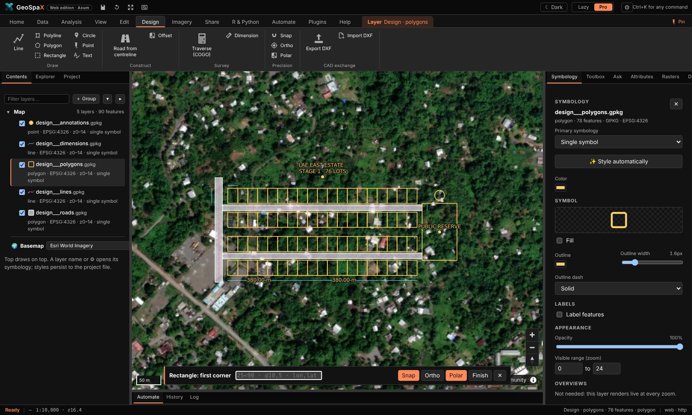

**What it is:** a 76-lot estate drawn with the Design tab (CAD tools) — two 12 m access roads, a 15 m
collector, 20 × 30 m lots, a reserve, a water tank and dimensions, all typed on the command line —
exported to DXF in UTM metres.

**Make it:**

1. Zoom to your site on imagery (the shot is over Lae, Papua New Guinea).
2. **Design › Line** or **Shapes › Polyline**: draw the centreline of each road. The command line at
   the bottom takes typed input — `25<90` (25 m at bearing 90°), `@10,5` (relative x, y).
3. **Design › Road from centreline**: pick the centreline, type the width (12 m / 15 m) — it makes
   the road polygons.
4. **Shapes › Rectangle** for a lot; **Design › Array** repeats it into the grid; **Trim / Extend /
   Fillet** clean the corners; **Offset** sets lots back from roads.
5. **Precision** toggles while you work: **Snap** (to vertices/edges), **Ortho** (right angles),
   **Polar** (angle steps).
6. **Design › Dimension** for the measurement callouts; **Survey › Areas** for the lot area table;
   **Traverse (COGO)** if you have a measured boundary to adjust.
7. **Design › Layers** manages colours, linetypes and locks, like a CAD layer manager.
8. Hand it to AutoCAD: **CAD exchange › Export DXF** (in the CRS units — the shot is PNG94/UTM 55S).

### Rivers and catchments from the 30 m DEM

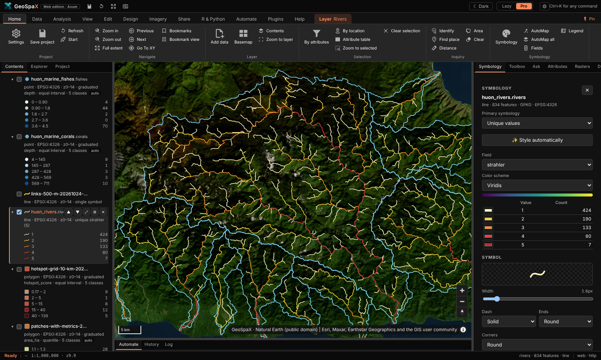

**What it is:** the Markham valley from the Copernicus GLO-30 DEM: depressions filled, D8 flow
routing, 1,674 stream links coloured by Strahler order 1 to 5, and the 7 basins wholly inside the DEM.

**Make it:**

1. Get the DEM for your area: **Explorer › Online data › Elevation** (Copernicus 30 m, fetched as a
   cloud-optimised GeoTIFF window over HTTP — seconds, not a download of the world).
2. Select the DEM layer.
3. **Imagery › Terrain** group, or the Toolbox tool **hydro.network** (Analysis › Toolbox, search
   "hydro"): it fills depressions, routes flow (D8), extracts stream links with Strahler order and
   delineates basins. Basins cut by the DEM edge are left out.
4. The streams come out already styled by order (the dark-to-light blue ramp in the shot); basins as
   outlines.
5. Want it for a different area? The **terrain-report** recipe does DEM → relief, slope, aspect,
   contours and slope classes in one run: **Analysis › Recipe gallery › Terrain report**, or
   `geospax run terrain-report --input area=your-layer` — it fetches the DEM itself.

### Land cover snapshot, Lae (ESA WorldCover 2021, 10 m)

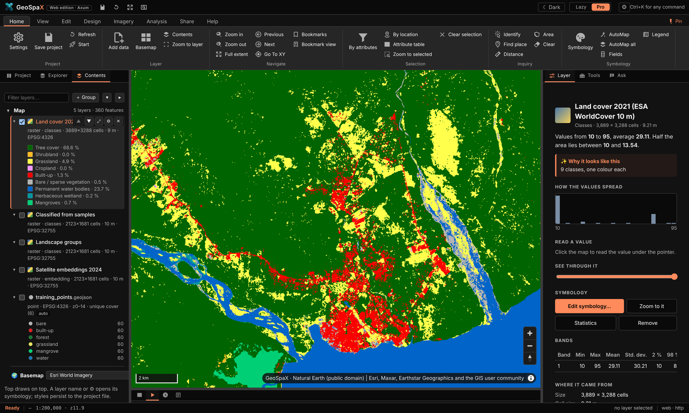

**What it is:** a snapshot of what covers the ground in one year, 2021, at 10 m, drawn in ESA's
class colours. Around Lae the legend shows tree cover 57.6 %, open water 28.7 %, grassland 7.8 %,
built-up land 3.0 % and mangroves 1.7 %. It does not show change; for that, see the forest change
map (LULC plugin, year of forest loss 2001 to 2025).

**Make it:**

1. Pan/zoom to the area you care about.
2. **Explorer › Online data › Land cover** (ESA WorldCover). GeoSpaX clips it to the map window and
   cites the source on the map.
3. It arrives styled in the official class colours (forest green, crop yellow, built-up red),
   with the area-share legend automatically.
4. Change a class colour or label: **right › Layer tab** while the raster is selected.

### Supervised classification: nine land-cover classes from satellite embeddings

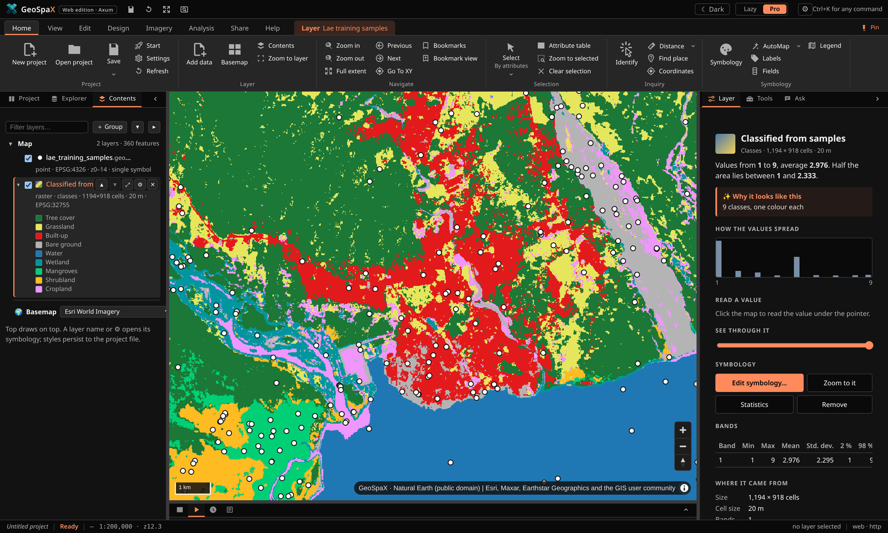

**What it is:** Google DeepMind's AlphaEarth satellite embeddings (64 values per pixel, 1.1 million
pixels at 20 m), k-nearest neighbours trained on 360 points labelled from WorldCover (the white dots):
nine classes, leave-one-out accuracy 80.3 %.

**Make it:**

1. Get embeddings for the area: **Imagery › Satellite embeddings › Embeddings** (downloads the
   AlphaEarth field for the current extent).
2. Get training samples: drop or draw a point layer with a class field — the tour used points
   labelled by WorldCover class.
3. **Imagery › Classify** (Satellite embeddings group), or the **embeddings-classify** recipe:
   it trains kNN on the samples, predicts the whole extent and reports leave-one-out accuracy.
   CLI: `geospax run embeddings-classify --input area=your-area --input samples=your-points`.
4. The result comes out styled by class with the accuracy in the report.

### Unsupervised classification: landscape groups, no samples needed

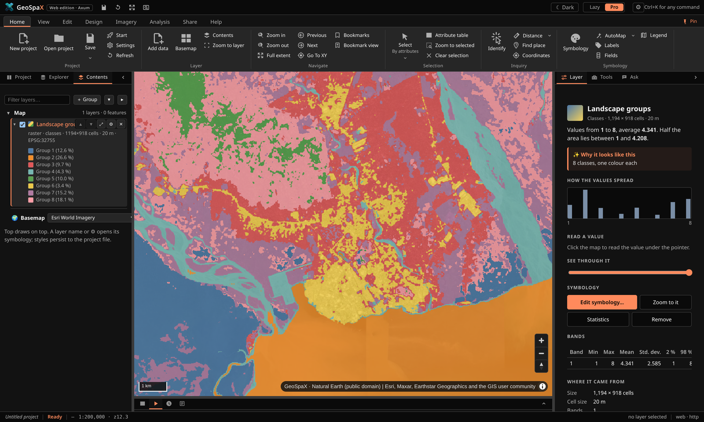

**What it is:** the same embeddings grouped into eight landscape kinds by k-means — 3.6 M pixels in
under a minute, zero training data.

**Make it:**

1. **Imagery › Embeddings** for the area (as above).
2. **Imagery › Group landscape** — pick the number of groups (8 here).
3. Done — the classes are machine-found, so colours are categorical; recolour in the Layer tab and
   rename classes once you recognise what each is ("mangrove", "urban", "gardens"…).
4. Cousins in the same group: **Similar places** (find pixels that look like a clicked spot) and
   **Change** (same landscape, different years).

### LiDAR in 3D: point cloud to extruded buildings

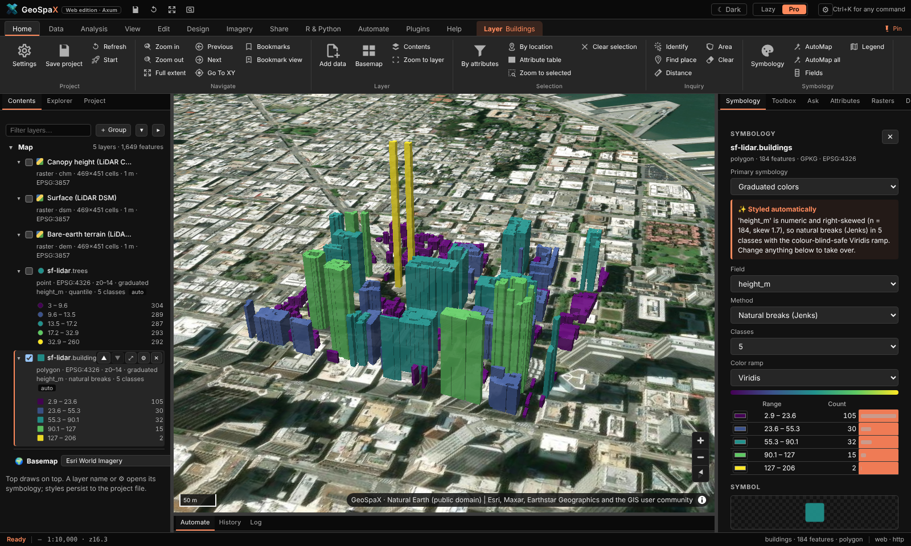

**What it is:** 23 M USGS 3DEP points over downtown San Francisco gridded in 12 s into terrain,
surface and canopy models; 184 buildings found and raised to measured roof heights over imagery.

**Make it:**

1. Drop LAS/LAZ tiles (or a folder, or plug in the drive holding them) — the drop folder or
   **Explorer › Devices** also works. A folder of files becomes a LiDAR *device* automatically.
2. Run **LiDAR → terrain**: **Imagery › LiDAR**, the **lidar-to-terrain** recipe
   (Analysis › Recipe gallery), or `geospax run lidar-to-terrain --input source=/path/to/tiles`.
   Ground comes from the files' own classification, else the SMRF filter.
3. You get a DTM, DSM, canopy heights, tree tops and building outlines with measured heights — each
   a normal layer you can restyle.
4. **View › 3D terrain** raises the DTM as terrain; select the buildings layer and use
   *Extrude in 3D* to lift them to roof height (what you see in the shot).
5. The run also writes a glTF scene (`scene.glb`) and a self-contained `scene.html` viewer in the
   run folder — no install needed to share the 3D.

### Network analysis: how far is the nearest clinic by road

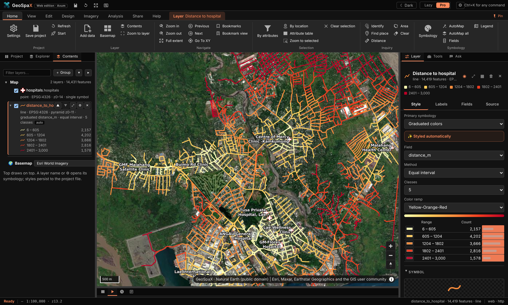

**What it is:** a service area from 16 hospitals and clinics (red crosses) over 2,456 Overture roads:
streets within 500 m (green), 1 km (yellow) and 2 km (orange) by road of the nearest one, and grey
beyond that, so the gaps in access stand out.

**Make it:**

1. Roads: **Explorer › Online data › Roads** (Overture), or drop your own road network.
2. Facilities: drop a points layer of clinics/depots/stores.
3. **Analysis › Network › Service area** (the Tools group also has **Closest facility** and
   **Shortest path** for A to B). Pick the road layer, the facilities layer and the break distances
   (500, 1000, 2000 m in the shot).
4. Every node reached gets its road distance and band; style the roads by band, green to orange, as
   in the shot. **Closest facility** instead gives every segment its distance to the nearest site.
5. The same bands from one or more depots are the basis of the *delivery-routes* industry kit below.

### Mount Wilhelm: DEM in seconds, then in 3D, then as print relief

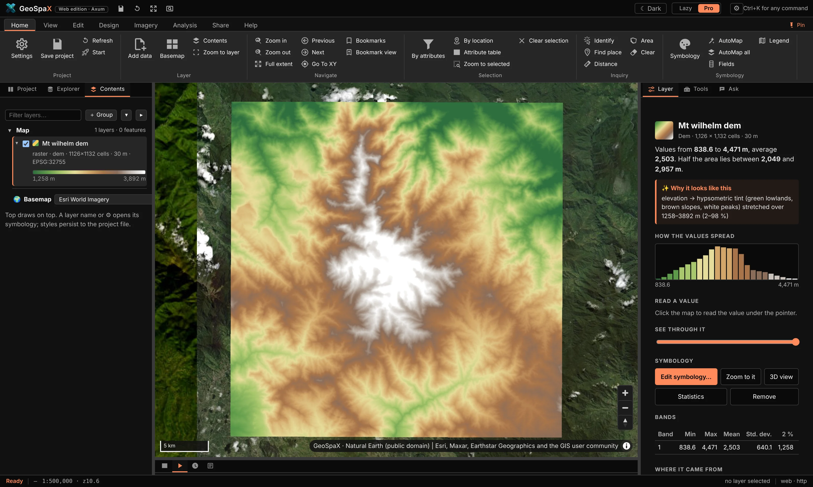

**What it is (1/3):** the GLO-30 DEM around PNG's highest peak (338 to 4,473 m), hypsometric tint green
to white, with histogram and band stats.

1. Zoom to Mount Wilhelm (or any place).
2. **Explorer › Online data › Elevation** — the DEM arrives in ~4 s, already tinted.
3. **right › Layer tab** shows its band statistics and the histogram; change the ramp or the
   breakpoints there.

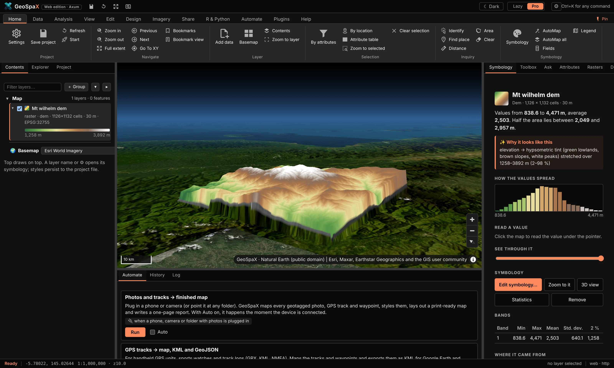

**What it is (2/3):** the same DEM raised as live 3D terrain over imagery.

4. With the DEM on the map, press **View › 3D terrain**. Drag to tilt; the exaggeration is set
   from the data, adjustable in the Layer tab.

**What it is (3/3):** a print-quality version — imagery warped onto the DEM, ray-traced shadows and
ambient occlusion, rendered in R with rayshader (the `relief-wilhelm` image on the site).

5. Needs R installed (**Help › Diagnostics** checks it). Run the **3D relief with rayshader**
   analysis: **Analysis › Recipe gallery**, or `geospax run r-rayshader --input area=your-area`.
6. It writes the rendered PNG plus a shaded-relief map and a report into the run folder.

### The twelve domain plugins

Each domain plugin is a bundle of analyses on the same engine — run from **Explorer › Plugins** or
its ribbon tab. On open data around Lae they made these:

| Plugin | What its map shows | Run it with |
| --- | --- | --- |
| **Agriculture** | Cropland suitability: gentle slope (weight 3), open land (2), low ground (1) on 2,529 cells of 1 km | `agriculture` plugin › suitability |
| **Biodiversity** | 1,904 GBIF bird records on 5 km hexagons: 244 species, richness, Shannon, Simpson, evenness | `biodiversity` › richness grid |
| **Climate** | Flood exposure: land cells scored by low ground (2) and low average elevation (1) | `climate` › flood exposure |
| **Conservation** | 1,197 OBIS fish records on an 8 km hotspot grid: 68 of 740 cells hold records | `conservation` › hexagon hotspots |
| **Disaster** | Landslide susceptibility: slope (3) + local relief (2) + low tree cover (1), 0 to 1 | `disaster` › susceptibility |
| **Environment** | Elevation profile from the Lae coast (Huon Gulf) to the Saruwaged Range: 39.1 km, rising from 0 to 1,726 m (total climb 4,684 m). Open it with Analysis › Profile chart. | `environment` › profile |
| **Forestry** | 69 Hansen forest patches of 20 ha or more: patch metrics and core forest 300 m from any edge (83.7 % core) | `forestry` › fragmentation |
| **Geoscience** | Horn slope in three zones: 41 % under 8°, 23 % from 8° to 20°, 36 % at 20° and over | `geoscience` › slope zones |
| **Hydrology** | Wet ground: low, gentle, open cells where water gathers | `hydrology` › suitability |
| **LULC** | Forest change 2001 to 2025: the year each patch of forest was lost (Hansen Global Forest Change), 18,021 ha in total, worst in 2022 | **Online data › Hansen** (loss year) |
| **Marine** | 242 of 1,197 OBIS fish records flagged on land and dropped; the 955 marine records in 20 DBSCAN clusters over GEBCO bathymetry | `marine` › records on land, clusters |
| **Soil** | Erosion potential: steep slope (3) and open ground (2) on the land cells | `soil` › erosion potential |

**Marine records on land.** OBIS and GBIF hold many old museum specimens georeferenced to a town, an island or a 0.1° grid point, so some "marine" records fall inland. `marine` › *Records on land (marine QC)* flags each record whose surroundings, within a coastal tolerance (1 km by default), hold no sea cell of an elevation or bathymetry raster such as GEBCO, or that lies inside a land polygon layer (OSM land polygons, Natural Earth 10 m land); it adds `on_land` and `min_elev_near_m` and can drop the flagged records. *DBSCAN clusters* takes the same land mask and drops records on land before clustering by default.

To run one: **Explorer › Plugins**, open the domain card, pick the analysis, fill the form, **Run**.
Every one writes a styled layer, a report, and (where relevant) intermediate layers you can restyle.
The plugin screenshots in `docs/assets/plugin-*.png` were all made that way on the open data above.

### The twelve industry kits

The industry kits are **recipes** — the same steps a professional would click, saved and repeatable.
Each made one print-ready map on real Papua New Guinea locations (see `docs/assets/industry/`).
Run them from **Analysis › Recipe gallery**, or `geospax run kit-<name>`.

| Kit | What it does | Inputs it asks for |
| --- | --- | --- |
| **kit-survey-plan** | Bowditch traverse adjustment, per-lot bearings/distances, survey plan + UTM grid | traverse legs, start point, lots layer, CRS |
| **kit-power-corridor** | Corridor zones on a transmission line, encroaching buildings, LiDAR clearance, tower inventory | line layer, buildings, (optional) LiDAR |
| **kit-petroleum-leases** | Licence areas, overlap flags, wells vs protected land, least-cost pipeline | lease polygons, wells, protected areas |
| **kit-mine-volumes** | Cut/fill between two elevation surveys; tenements, overlaps, expiry | two DEMs or surveys, tenement polygons |
| **kit-harvest-planning** | Net harvestable coupes after stream buffers, least-cost haul road | coupe polygons, streams, slope limit |
| **kit-maritime-watch** | AIS ping density, vessel tracks, loitering events, transmission gaps | AIS points/tracks |
| **kit-aerodrome-safeguarding** | ICAO Annex 14 obstacle limitation surfaces for a runway, obstacles that break them | runway, buildings/obstacles |
| **kit-delivery-routes** | Drive-time service areas from a depot, optimised stop order | road network, depot, stops |
| **kit-urban-planning** | Zoning summary, housing density, 400 m walk access to green space | land use, buildings, parks |
| **kit-rural-access** | Settlement access to clinics and schools with slope context | villages, services, DEM |
| **kit-asset-register** | Asset age/condition risk, alerts since the last register | asset points/polygons + register table |
| **kit-el-nino-drought** | Rainfall % of normal, anomaly class, drought risk scaled by the Oceanic Niño Index | rainfall raster or a province layer |

**To make one look like the site shots** (dark theme, Pro mode): **View › Theme › Dark**, run the
kit, open its map artifact from **History**, then **Share › Export map** for a print-ready version
with your own title and credits.

### Tips that apply to every tour

- **Everything is a layer.** Intermediate results (slope, basins, buffers) stay on the map —
  restyle, rename or delete them like anything else.
- **Everything is a recipe.** What a button did is saved as a re-runnable recipe in **History** —
  open a finished run to see the exact steps and reuse them on your data.
- **AutoStyling is a start, not a wall.** Every colour, class break and label can be changed in the
  Layer tab; AutoMap's reason for each choice is shown next to it.
- **Offline vs online.** File/device tours work fully offline. DEM, WorldCover, Overture, OBIS and
  STAC tours fetch just the area on your map, then work from the local copy.

## 3. Where things go

The installed desktop app keeps everything in one folder:

```
~/GeoSpaX/
├── Inbox/       drop photos, tracks, drone and sensor logs here → the matching recipe maps them
├── Data/        put GIS layers here (GeoPackage, Shapefile, GeoJSON, FlatGeobuf, GeoTIFF …)
│                → they appear in the layer list next time GeoSpaX starts
├── .geospax/    state: runs/ (finished maps, PDFs, reports), overviews, project, Auto switches
└── README.txt
```

When you start it from a terminal with a folder (`geospax /path/to/data`), or with `GEOSPAX_DATA` set, it uses
that folder instead. State then goes into `<folder>/.geospax`.

## 4. Recipes in the box

**Run any recipe in three clicks:** 1) **Analysis › Recipe gallery** (or a recipe card under
**Explorer › Recipes**) → 2) fill the inputs it asks for (each has a plain-words description and a
sensible default — `auto` picks your most sample-like layer) → 3) **Run**. Watch it in **Automate**,
open the result in **History**, or find every finished map under **Your finished maps**.

| Recipe | Makes | Runs by itself when |
|---|---|---|
| `photos-to-map` | Photos and tracks → finished map | Geotagged photos land in the Inbox, or (on Auto) a phone or camera is plugged in |
| `track-to-map` | GPS tracks → map, KML and GeoJSON | Tracks land in the Inbox, or (on Auto) a GPS unit is plugged in |
| `drone-flight-report` | Drone flight → coverage map and report | Drone logs land in the Inbox, or (on Auto) a drone card is plugged in |
| `sensor-log-to-map` | Sensor log → map and report | A sensor log lands in the Inbox, or (on Auto) a logger is plugged in |
| `air-quality-alert` | Alert map of live sensors | A live PM2.5 reading goes above 35 µg/m³ (30 min cooldown) |
| `latest-ndvi` | Latest cloud-free NDVI (Sentinel-2) | A new satellite pass covers your area (when on Auto) |
| `lidar-to-terrain` | LiDAR point clouds (LAS/LAZ) → terrain map, canopy map with tree tops and buildings, **3D scene**, report | LAS/LAZ files land in the Inbox, or (on Auto) a drive with point clouds is plugged in |
| `terrain-report` | DEM → relief, slopes, contours, **3D view** | You press Run |
| `landforms-grass` | Landforms with GRASS r.geomorphon | You press Run (needs GRASS) |
| `wetness-saga` | Topographic wetness index with SAGA | You press Run (needs SAGA) |
| `interpolate-samples` | Field samples → the best surface: **kriging or IDW**, whichever predicts better, plus a map of how sure it is | You press Run |
| `points-to-hotspots` | Incidents → **hot spot map** (where they cluster more than chance explains) | You press Run |
| `r-kriging` | Kriging prediction and uncertainty (R gstat) | You press Run (needs R) |
| `python-spatial-stats` | Centre, spread and clustering of points | You press Run (needs Python 3) |
| `points-to-hexbins` | Hexagon density map for very many points | You press Run |

To make your own recipe, use **Save this map as a recipe** in the app, or copy one of the examples from
`/usr/share/geospax/recipes/` (source: [`recipes/`](../recipes)) into a folder and point `GEOSPAX_RECIPES` at it.
The format is described in [AUTOMATION.md](AUTOMATION.md).

## 5. Automation on and off

Every recipe with a trigger has an **Auto** switch in the Automate section. Your choices are saved in
`.geospax/automation.json`. From a terminal:

| Setting | Desktop (environment variable) | Web edition (flag) |
|---|---|---|
| Recipes on Auto | `GEOSPAX_AUTO=photos-to-map,track-to-map` or `all` | `--auto …` |
| Extra drop folders (mapped without Auto) | — (`~/GeoSpaX/Inbox` is built in) | `--inbox DIR` (repeatable) |
| Extra watched folders (treated like devices) | `GEOSPAX_WATCH=/path/one:/path/two` | `--watch DIR` (repeatable) |
| Import new devices without a recipe | `GEOSPAX_AUTO_IMPORT=1` | `--auto-import` |
| Extra recipe folders | `GEOSPAX_RECIPES=DIR` | `--recipes DIR` |
| Live sensors over MQTT | `GEOSPAX_MQTT=mqtt://host:1883/sensors/#` | `--mqtt …` |
| Live GNSS receiver | `GEOSPAX_GPS=gpsd://localhost:2947` or a serial/TCP/file URL | `--gps …` |
| Data and state folders | `GEOSPAX_DATA`, `GEOSPAX_STATE` | `--data DIR`, `--state-dir DIR` |
| Everything off | — | `--no-triggers` |

## 5a. Edit and query data

The **Edit** tab works like ArcGIS Pro's (and QGIS's digitising and attribute tools). Edits go into the
**active layer**: the one picked in Contents.

| Group | Tools |
| --- | --- |
| **Create** | **Point**, **Line**, **Polygon**: click to place vertices, double-click (or click the first point) to finish, then fill in the feature's attributes. New vertices **snap** to the vertices of visible features (Manage edits › Snapping turns it off). |
| **Modify** | **Select** (click; Shift adds, Ctrl removes, Delete deletes), **Select by rectangle**, **Edit vertices** (drag a vertex or the whole shape, drag a midpoint to add a vertex, right-click a vertex to delete it; Enter saves, Esc cancels), **Attributes** (form for the selected feature), **Delete**. |
| **Selection** | **By attributes**: a query builder (field, operator, value list, AND/OR) that writes an SQL WHERE clause you can edit and **Check** before selecting; new selection, add, remove or select from the current one. **By location**: features that intersect, lie completely within, contain or are within a distance (metres) of another layer's features, or only its selected ones. **Zoom to selected**, **Clear selection**. The same selection tools are on the Edit tab. |
| **Fields** | **Calculate field**: an SQL expression (`"a" * 2`, `round("x", 2)`, `"a" \|\| ' ' \|\| "b"`, `CASE WHEN "x" > 10 THEN 'high' ELSE 'low' END`, `upper()`, `substr()`, `coalesce()` …) or a **geometry** measure (geodesic area in m², ha or km², length, perimeter, x, y), for all features or the selected ones; a new field is created with the type you choose. **Add field**, **Attribute table**, **Definition query** (only matching features are drawn, listed and analysed until you clear it; the data is not changed). |
| **Manage edits** | **Undo**/**Redo** (Ctrl+Z, Ctrl+Y) step through whole edits, including deletions; **New layer** (empty points, lines or polygons with the fields you list); **Export features** (the selection or the layer as a new layer); **Discard edits**. |

**Measure** (Home tab and Edit tab): **Distance** sums the segments you click; **Area** gives the area and
perimeter of the shape you click. Both are geodesic (measured on the globe, not on the flat map), in metric
or imperial units (click the unit button); double-click or Enter finishes, Backspace removes the last
point, Esc closes. **View › Projection** switches the map between Web Mercator and a **Globe**.

**Your files are safe.** The first edit to a layer copies it, with its coordinate system, fields and
feature ids, into a GeoPackage that GeoSpaX keeps in its state folder (`<state>/edits/`); from then on the
layer (same name, same style) reads the copy, and it comes back the next time you start. The original
file is never written. **Discard edits** goes back to it; **Export** (or the attribute table's Export) saves the edited
data wherever you like.

**The attribute table** (the **Attributes** tab under the map) shows every field. Click a column name to sort (again for
descending, a third time for none); its **⋮** menu sorts, calculates, shows statistics or deletes the field.
The search box looks through every text and number field of the whole layer, not just the page on screen.
Clicking a row selects the feature on the map (Shift selects a range, Ctrl adds or removes); double-click
the id to zoom to it and double-click a cell to edit it. **Show selected** lists only the selection;
**Switch** selects the others. The toolbar has the same Select by attributes, Filter (definition query),
Calculate, Add field, Delete and Export as the ribbon.

The engine's API does the same for scripts: `POST /api/layers/{id}/select`, `…/table`, `…/calculate`,
`…/features`, `PUT …/filter` ([README](../README.md), section API).

### SQL across layers

**Analyze › SQL** runs one read-only query across every layer on the map, even when they come from different files (a GeoPackage, a shapefile and a CSV in one join). It uses GDAL's SQLite dialect with SpatiaLite functions. Name a layer by its id in double quotes (click a layer name above the editor to insert it):

```sql
SELECT p.province, count(*) AS clinics
FROM "clinics" c JOIN "provinces" p ON ST_Intersects(c.geometry, p.geometry)
GROUP BY p.province
```

A result without geometry shows as a table (the first 5,000 rows). A result with geometry is saved to `outputs/sql/<name>.gpkg` and joins Contents as `sql.<name>`. Only `SELECT` and `WITH` statements run; writes, `ATTACH`, `PRAGMA` and file paths are refused. The same query is `POST /api/sql` with `{"sql": "...", "name": "..."}`. Definition queries on a layer are not applied inside SQL; add a `WHERE` instead.

The query engine is GDAL's SQLite dialect, not DuckDB. A DuckDB engine (for very large GeoParquet) is a later step.

## 5b. LiDAR point clouds

Put the `.las` or `.laz` files from a drone LiDAR survey (exported from DJI Terra, Pix4D and the like), an aircraft
survey or a national LiDAR portal into `~/GeoSpaX/Inbox`, a folder of tiles included. About ten seconds later you
have:

- a **terrain map**: the bare ground with buildings and trees taken away, shaded, with contours and building outlines;
- a **canopy map**: how tall the vegetation is, a dot on every tree top, buildings in grey;
- `dtm.tif`, `dsm.tif` and `chm.tif` (ground, surface and canopy height), and `trees` and `buildings` layers with
  heights, in the results folder;
- a **3D scene** (see 5c);
- a report with the point density, the canopy cover, and the number and height of trees and buildings.

If the files were classified by the vendor software, GeoSpaX uses that classification. If not, it finds the ground
itself. A file that doesn't say where on Earth it is (some phone scans and exports) stops with a message; run it
again with the EPSG code of the survey: `geospax run lidar-to-terrain --input source=FILE --input epsg=32755`.
Details: [AUTOMATION.md §6c](AUTOMATION.md#6c-lidar-point-clouds-built).

**Step by step:** 1) drop LAS/LAZ files on the window or in `Inbox/` → 2) the
**lidar-to-terrain** recipe runs itself → 3) the map gets DTM/DSM/canopy rasters plus `trees` and
`buildings` vector layers → 4) raise them with **View › 3D terrain** and *Extrude in 3D*.
Full walkthrough with the San Francisco example: [§2d · LiDAR in 3D](#lidar-in-3d-point-cloud-to-extruded-buildings).

## 5c. 3D scenes

The LiDAR and terrain recipes also build a 3D scene by themselves. The terrain is a block diagram in its map colours
with the relief shaded, contours painted on, buildings at their measured heights, trees at their heights and crown
widths, and the point cloud. You get it three ways:

- **In the app:** press **🧊 3D** on the recipe's card. Drag to turn, right-drag (or Shift-drag) to move, scroll or
  pinch to zoom, click the compass to face north, double-click to start again. The switches at the top show or hide
  the terrain, buildings, trees and point cloud.
- **`scene.html`** in the results folder: the same viewer with the model inside. It opens in any browser, offline,
  so you can e-mail it or put it on a USB stick.
- **`scene.glb`**: a standard glTF 2.0 model for Blender, Windows 3D Viewer, ArcGIS Pro, CesiumJS or a 3D printer's
  slicer. The report also shows a 3D picture.

Flat land is raised a little so you can read it: at most 1.5× for detailed surveys, up to 3× for big areas. The note
on the picture says by how much. Buildings and trees always keep their true heights. To add a 3D scene to your own
recipe, add a `scene.3d` step after any elevation raster ([AUTOMATION.md §6d](AUTOMATION.md#6d-3d-scenes-built)).

**Step by step:** 1) any DEM on the map (LiDAR DTM or `dem.fetch` output) → 2) **View › 3D terrain**
raises it live → 3) a `scene.3d` recipe step exports `scene.glb` + `scene.html`. The interactive
viewer needs no install — drag to orbit, right-drag to pan, scroll to zoom.

## 5d. Hot spots and kriging (no R or Python needed)

**Hot spots.** Put a file of incidents (crimes, crashes, disease cases, complaints: any points) in your Data folder
and run `points-to-hotspots`. GeoSpaX counts them in hexagons, works out the distance at which they cluster most, and
colours each hexagon: **red** where incidents cluster more than chance would explain (90, 95 or 99 % sure), **blue**
where there are fewer than expected, pale where nothing stands out. It corrects for testing hundreds of hexagons at
once, so a few red cells are not just luck. The report shows the map, how many hot and cold spots there are, the
distance used and a chart of how it was chosen. To map hot spots of a value instead (house prices, pH, yields), set
the `field` input.

**Kriging.** `interpolate-samples` turns field samples into a smooth surface. It tries kriging (which learns from
the samples how fast values change with distance) and IDW, tests both by leaving out each sample in turn and
predicting it from the rest, and keeps the one that predicts better. With kriging you also get an **uncertainty map**:
pale near your samples, dark where the surface is a guess. That is where to sample next. The report shows the error of
each method and the variogram (the chart of how quickly samples stop resembling each other).

Both are checked against R's spdep and gstat, and give the same numbers. Details: [AUTOMATION.md §6e](AUTOMATION.md#6e-spatial-statistics-built).

**Step by step (hot spots):** 1) drop a points file (incidents, cases, complaints) in `Data/` →
2) run `points-to-hotspots` from **Analysis › Recipe gallery** or `geospax run points-to-hotspots` →
3) hexagons appear coloured red (clusters), blue (gaps), pale (nothing special) → 4) the report in
**History** shows the map, the distance it chose and how.

**Step by step (kriging):** 1) a points layer with a number field → 2) run `interpolate-samples`
(it tries kriging *and* IDW, cross-validates both, keeps the better one) → 3) you get the surface plus
an uncertainty map — dark where the guess is thin, telling you where to sample next.

## 5e. Ask about your data (AI)

**Analysis › Ask** (or the **Ask** tab on the right) answers questions about your layers in plain
words, such as *"How many sites are above 2000 m? Select them."* It reads your data through GeoSpaX's
own tools, gives figures only from what they return, and lists every tool it used under the answer.
It can select features, zoom, and start recipes that do not run code. The model runs where you choose
in **Model…**: Ollama on this computer (nothing leaves it), an OpenAI-compatible server, or Claude with
your own API key. `geospax-server mcp` offers the same tools to Claude Desktop, Claude Code and other
MCP clients.

**Imagery › Embeddings** reads Google DeepMind's AlphaEarth satellite embeddings for your area: 64
numbers per 10 m pixel that sum up a year of satellite observations. Use them to find places like
your sample points, group the landscape, classify it from labelled points, or map change between two
years. See [AI.md](AI.md).

## 6. Live sensors and phones

- **MQTT:** point GeoSpaX at a broker (`GEOSPAX_MQTT` / `--mqtt`). Publish JSON such as
  `{"lat": -9.44, "lon": 147.18, "pm2_5": 41}` to `sensors/<id>`.
- **HTTP:** POST the same JSON to `/api/devices/live`.
- **Brokers on the internet:** use `mqtts://host:8883/topic/#`. Certificates are always checked; add `?ca=ca.pem` for a
  broker with its own CA, and `?cert=client.pem&key=client.key` where the broker wants a client certificate.
- **LoRaWAN sensors:** subscribe to your The Things Stack application
  (`mqtts://APP-ID@ttn:API-KEY@eu1.cloud.thethings.network/v3/%2B/devices/%2B/up`) or your ChirpStack server
  (`mqtt://host/application/%2B/device/%2B/event/up`). Each uplink's decoded values and signal strength go on the map,
  at the sensor's GPS position or near the gateway that heard it.
- **Public sensor networks (OGC SensorThings):** `--sta https://host/v1.1` (desktop: `GEOSPAX_STA`) shows every station
  with its latest values and updates them when they report.
- **Phones:** the free OwnTracks app works with no GeoSpaX app on the phone.

Live devices appear in the **Devices** section, and `sensor` triggers can fire recipes on thresholds or geofences.
Details and message formats: [DEVICES.md §4](DEVICES.md#4-sensors-in-detail).

**Step by step (a sensor on the map, 60 seconds):** 1) start the server with
`geospax-server --data data --mqtt mqtt://localhost:1883/sensors/#` → 2) publish
`{"lat":-9.44,"lon":147.18,"pm2_5":41}` to `sensors/1` → 3) the point appears under
**Explorer › Devices & phones** → 4) enable a `sensor` trigger (e.g. the air-quality recipe) and the
map *makes itself* when a reading crosses the threshold.

## 7. Optional power tools: R, Python, GRASS, SAGA

Recipes that use these tools work once the tool is installed. On Debian:

```sh
sudo apt install python3                       # python-spatial-stats
sudo apt install r-base-core r-cran-sf         # R steps; then in R: install.packages("gstat")
sudo apt install grass-core saga               # landforms-grass, wetness-saga
sudo apt install mosquitto                     # a local MQTT broker for live sensors
```

## 8. Command line

Both programs take the same subcommands, and none of them opens a window:

```sh
geospax recipes                                   # list recipes
geospax check my-recipe.yaml                      # validate a recipe
geospax run track-to-map --input source=~/tracks # run once on a folder or device, print the outputs
geospax watch                                     # run triggers headless (all recipes on Auto)
```

## 9. Privacy

Your photos, tracks and sensor readings are processed on your own machine. Nothing is uploaded. Only recipes that
fetch public data go online: the Copernicus DEM for terrain, and Sentinel-2 scenes from the Earth Search STAC
catalogue. See [DEVICES.md §5](DEVICES.md#5-privacy-and-safety).

## 10. Troubleshooting

| Problem | Try |
|---|---|
| No layers in the list | Put files into `~/GeoSpaX/Data` and restart GeoSpaX |
| A plugged-in device is not listed | Check that it is mounted (Linux: under `/media/$USER`). Phones must be in *file transfer* mode. Or copy its files into `~/GeoSpaX/Inbox` |
| The device is listed but no map is made | Press **Import & map**, or turn on the recipe's **Auto** switch. A device that was already handled with the same content is not processed twice: add a file, or press **Run** |
| An R, GRASS or SAGA recipe fails | Install the tool (section 7). The run's log names the missing piece |
| Windows: "Windows protected your PC" | The installer isn't code-signed yet. Click *More info → Run anyway* |
| Windows: the GeoSpaX window stays blank | WebView2 is missing or broken. Reinstall it from Microsoft ("WebView2 Runtime"), or use **GeoSpaX Web Server** in the meantime |
| Windows: an SD card or camera is not listed | GeoSpaX watches removable drives and drives with `DCIM`/`GARMIN` folders. Phones in MTP mode are not read on Windows yet: copy their photos into `%USERPROFILE%\GeoSpaX\Inbox` |
| Anything else | Start `geospax` from a terminal (Windows: `geospax-server.exe` in the install folder, `%LOCALAPPDATA%\GeoSpaX`). It logs what it detects and runs. Please include that log in bug reports |
